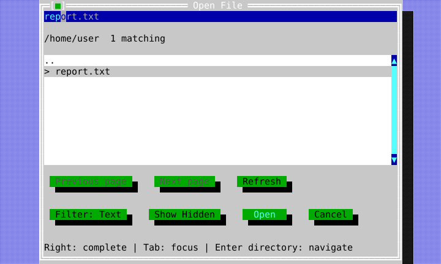
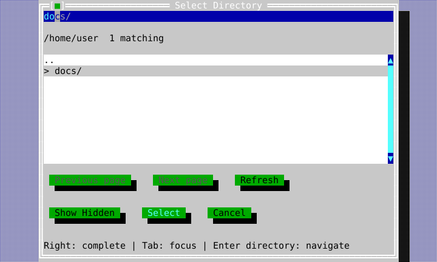
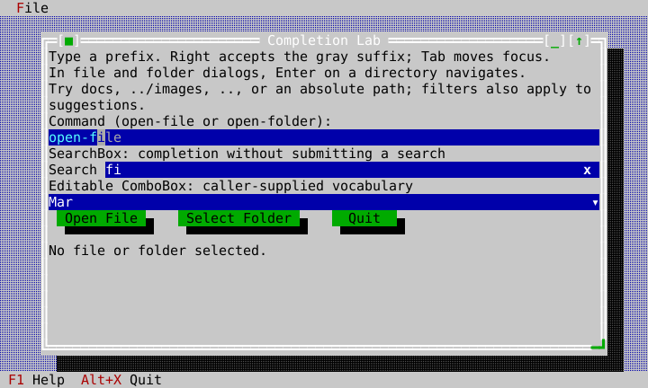

<!-- Copyright (c) 2026 C. Klukas. All rights reserved. -->
<!-- SPDX-License-Identifier: MIT -->

# Input completion

InputLine offers optional inline completion. The subdued suffix is a preview;
text(), validation, clipboard, and history contain only the committed value.
Plain Right accepts the preview at an unselected end caret. Tab and Shift+Tab
continue to move focus. Enter keeps the field's ordinary submit behavior.

For a fixed vocabulary, add one call to an existing field:

```cpp
#include <cvision/widgets/input_line.hpp>

auto* field = parent.make<ckv::widgets::InputLine>();
field->set_completions({"report.csv", "report.txt", "results.json"});
field->set_text("rep");
```

While focused, this previews "ort.csv" after "rep". Right commits "report.csv"
as one undoable edit, runs the validator, and sends one on_edited notification.
Undo restores "rep". Right within text and modified arrows retain ordinary
caret movement. Escape dismisses a visible suffix for the current query;
another Escape reaches the surrounding control. Editing starts a new query.
Password and masked fields do not offer completion and do not send their
contents to a provider.

The suffix uses the standard ckv.input.completion theme role, retaining the
actual input surface background. Built-in themes give it a subdued foreground
and dim attribute. Preview rendering clips complete graphemes and never paints
half of a combining or emoji cluster.
An insertion that would join the preceding committed grapheme offers no
inline suffix; explicit acceptance still resegments the complete edit safely.

## Custom sources

Implement CompletionProvider and pass an owned reference:

```cpp
field.set_completion_provider(std::make_shared<MyCompletionProvider>(source));
```

request() receives committed UTF-8 text, caret/selection in graphemes, and a
monotonic field-local revision. snapshot() exposes the current publication.
InputLine ignores results for a different revision. Bind one provider instance
to one active field; sharing immutable source data between providers is fine.

A CompletionCandidate supplies a non-zero stable identity, a half-open
grapheme replacement range, and insertion text. Only exact prefix extensions
at an end caret get an inline suffix. Other replacements can be explicitly
selected and accepted with select_completion(id) and accept_completion().
Acceptance refuses an insertion if any of its graphemes fails the admission
filter, so it cannot silently commit a partial suggestion.

Publications hold at most kMaxCompletionCandidates (64) candidates, with each
insertion at most kMaxCompletionTextBytes (32768) bytes. Invalid UTF-8, control
characters, invalid ranges, and zero identities are rejected. Duplicate nonzero
identities reject the whole publication, preventing ambiguous selection. Pending, partial,
ready, and failed discovery states are explicit; partial results do not prove
that a match is unique. Providers rank candidates in their publication order.

Provider calls run on the UI thread and must be bounded and nonblocking. Do
not enumerate a directory, scan/sort a large source, or wait for work in
request() or snapshot(). Start work through an explicitly injected service;
publish its immutable result on the UI thread, then call
field.completion_changed(). Use normal owner lifetime checks before touching
the field, and never call back into it during provider methods. A stale worker
reply must retain its original revision rather than being relabeled as current.

refresh_completion() requests the same editing state with a new revision after
source or context changes. on_completion_changed lets a composite synchronize
its selected proposal with a list; preview changes do not invoke on_edited.
The provider remains alive while InputLine holds its shared reference. Provider
retirement must not wait for background work on the UI thread.

PrefixCompletionProvider owns and sorts a static vocabulary once, then uses
prefix lookup instead of scanning the whole vocabulary per keystroke. Matching
is case sensitive; typed spelling is preserved. Construct large vocabularies
outside dispatch, and keep a primary owner outside the view lifetime so final
vocabulary destruction also occurs there. Use an asynchronous provider for
dynamic data.

## File and folder dialogs

Use the DirectoryService overload for a real filesystem. Construct the service
at your application boundary, supply an exclusive index directory explicitly,
and keep it alive until after all dialogs and Application have been destroyed:

```cpp
#include <cvision/term/directory_service.hpp>
#include <cvision/term/posix_filesystem.hpp> // Windows: windows_filesystem.hpp

// Before constructing Application, outside UI dispatch:
auto fs = std::make_shared<ckv::term::PosixFileSystem>();
ckv::term::NativeDirectoryService directories(fs, index_directory, 2);

// Controller member, kept while its dialogs are open:
ckv::widgets::PendingDialogs pending;

// Inside a handler, with the service and controller still alive:
ckv::widgets::FileDialogOptions options;
options.filters = {{"Text", {"txt", "md"}}, {"All files", {}}};
auto picker = ckv::widgets::present_modal_file_dialog(
    ckv::widgets::FileDialogMode::Open, "/project", directories,
    options, app, desktop, roles);
pending.await(std::move(picker), [](ckv::widgets::FileDialogResult result) {
    // The window is detached; use result.path if result.accepted.
});
```

Typing narrows the visible page and suggestions together. Exact basename
prefixes preserve filename spelling; file-extension suffixes match without
ASCII case distinctions. Directories pass extension filters. Hidden names obey
the same toggle in both presentations. A proposed row carries a `>` marker and
is revealed without changing the path text or field focus. Selecting a matching
row chooses the proposal; a selected proposal survives partial reordering.
Byte-limited pages retain that proposal too. Paging from a page containing
only the chosen row resumes at its existing boundary instead of jumping.

Enter resolves only committed text. Existing directory paths navigate: `docs`,
`docs/`, `/project/docs`, `.`, `..`, and `../images` use filesystem semantics,
including links. Navigation keeps focus, extension filter and hidden policy, and probes
readability before committing the new base. Failed probes preserve the old base.
Native POSIX classification treats `C:/notes` as a relative folder path;
Windows treats drive-rooted and UNC paths as absolute.
Caret/focus changes reuse the current filename model and do not restart a
matching scan; unchanged-text caret movement leaves pending Enter classification
intact.
Other names retain the caller's existing open/save validation policy; failed
paths ending with a separator stay editable. Filter/result changes preserve
text. Right accepts a directory suggestion with its separator and starts
completion for the next segment. Keyboard focus normally offers existing text
selected (D-066); completion appears after typing or clearing that selection.

The responsive directory picker has the same path field and provider:

```cpp
auto folder = ckv::widgets::present_modal_directory_picker(
    directories, "/project", app, desktop, roles);
pending.await(std::move(folder), [](ckv::widgets::DirectoryPickerResult result) {
    // Select accepts only an existing directory; Enter in the field navigates.
});
```





## Large directories and ownership

NativeDirectoryService owns 1–8 explicitly configured workers, with one session
per occupied slot. Each request/result mailbox coalesces to one pending value;
three fixed handoff buffers preserve actor ownership without waiting. Discovery
streams into a worker-owned disk index. Typing and changing filters scan that
index rather than restarting filesystem enumeration. Canonical aliases
reuse discovery for the same folder. The known
visible subset is re-filtered immediately as partial matches when its folder
and generation still agree; a complete index search continues in the worker.
An unavailable typed parent keeps the preceding index available for return.
Matching/index reads
check for supersession every 256 entries. Enumeration checks between entries;
a blocked OS operation retains its slot until it returns.

Each publication has at most 64 entries and 32768 bytes of directory/name text,
including its owning pagination keys. Native browse paths are limited to 20479
UTF-8 bytes, leaving room for a maximum-size filename and both page boundaries.
Worker matching retains a bounded ordered page, not the complete directory.
Previous/Next page controls make all eligible entries accessible. Refresh
explicitly discards the discovery generation; external filesystem changes are
not silently treated as a live subscription. Index failures report a diagnostic
instead of falling back to unlimited memory. Names outside the supported
4096-byte, sanitized UTF-8 basename contract report discovery failure.

No enumeration, full-source sorting, index I/O, or worker join runs in field
handlers, list reads, draw, result publication, or dialog destruction. Closing
signals cancellation and retires the view immediately; a late result cannot
reach it. Service shutdown can wait for OS work, so destroy the service at the
host boundary after dispatch has ended. Native adapters permit concurrent
readers; a custom filesystem must support the configured workers. Scripted
filesystem objects must not mutate while their cursors are active.

The filesystem-only dialog overloads retain their released synchronous
small-tree behavior. They do not provide the scale contract above; use the
explicit service workflow for native directories.

## Completion Lab

Build the `ckvision_completion` target. Run it with an absolute starting path
and a unique, exclusive empty index directory. For example, on macOS:

```sh
workspace=$(mktemp -d /Volumes/PRO-BLADE/tmp/ckvision-completion-demo.XXXXXX)
export TMPDIR="$workspace"
/path/to/build/examples/ckvision_completion /path/to/files "$workspace/index"
```

On Windows the demo converts its native wide command-line arguments to UTF-8,
preserving non-ASCII names in both the starting folder and index directory.

The app demonstrates the same InputLine feature in a command field, SearchBox,
and editable ComboBox, then uses the responsive file and folder dialogs. Try
Right/Undo, Tab, extension filters, hidden files, `..`, and nested directory
paths. The real object graph is also tested and captured headlessly.



Implementation and remaining cross-platform/performance acceptance are tracked
in the checked-in completion plan, the internal plans.
