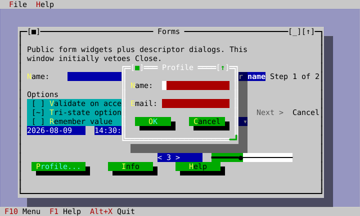
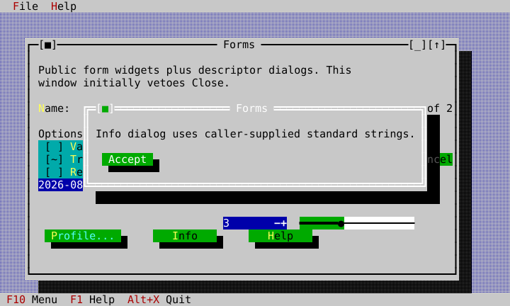
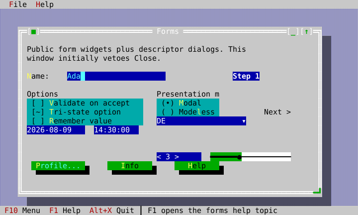

# Dialogs and commands

Register a command once, give it a title/chord/handler, and render it through
`CommandPresentation` in menus, toolbars, and status lines. Use a standard
presentation function for modal dialogs. This preserves one execution path,
one source of enablement, and typed completion rather than scattered callbacks.

## Command presentation

Hello registers its own application commands, while the larger examples attach
a handler to the framework's standard Quit command. The menu/status chrome is
then simple data that references a command id.

<!-- ckvision-snippet source="examples/hello/hello_app.cpp" lines="13-24" -->
```cpp
HelloApp::HelloApp(ui::Application& app) : app_(app), roles_(ui::intern_standard_roles(app.roles())) {
    app_.commands().add({.id = kCmdGreeting, .title = "&Greeting...", .category = "Hello", .chord = "Alt+G", .handler = [this] { greeting_box(); }});
    app_.commands().add({.id = kCmdQuit, .title = "&Quit", .category = "Hello", .chord = "Alt+X", .handler = [this] { app_.request_quit(); }});
    widgets::ApplicationShell shell(app_, {.theme = ui::make_classic_theme(app_.roles(), roles_),
                                           .menus = {{"&File",
                                                      {widgets::MenuItem{widgets::CommandPresentation{kCmdGreeting}},
                                                       widgets::MenuItem{"", ui::kInvalidCommand, {}, true},
                                                       widgets::MenuItem{widgets::CommandPresentation{kCmdQuit, "E&xit"}}}}},
                                           .status_items = {
                                               widgets::StatusLineItem{widgets::CommandPresentation{kCmdQuit, "&Quit"}},
                                               widgets::StatusLineItem{widgets::CommandPresentation{ui::std_commands::kMenu}}}});
    desktop_ = &shell.desktop();
```
<!-- /ckvision-snippet -->

Use `ApplicationShell` for a minimal common shell, or create `Desktop`,
`MenuBar`, and `StatusLine` directly when a larger app needs custom chrome.
The Gallery, Forms, and Workbench examples demonstrate the latter.

## Descriptor dialog with validation

The Forms app derives a descriptor from current state. Accept only completes
when each validator succeeds; invalid input retains modality and focus moves to
the failing field. Escape cancels.

<!-- ckvision-snippet source="examples/forms/forms_app.cpp" lines="174-199" -->
```cpp
    help->set_bounds(Rect{33, 14, 12, 2});
    help->on_press = [this] { present_help(); };
    help_button_ = help.get();
    content->add_child(std::move(help));

    window->set_content(std::move(content));
    window_ = desktop_->add_window(std::move(window));
}

widgets::DialogDescriptor FormsApp::make_profile_dialog_descriptor() {
    widgets::DialogDescriptor descriptor;
    descriptor.title = "Profile";
    descriptor.resizable = true;
    descriptor.fields.push_back(widgets::FieldDescriptor{
        "&Name:", name_input_->text(),
        [this](const std::string& value) {
            ++validation_attempts_;
            return !value.empty();
        }});
    descriptor.fields.push_back(widgets::FieldDescriptor{"&Email:", "", [](const std::string& value) {
                                                             return value.find('@') != std::string::npos;
                                                         }});
    descriptor.buttons.push_back(widgets::ButtonDescriptor{"&OK", true, [] {}});
    descriptor.buttons.push_back(widgets::ButtonDescriptor{"&Cancel", false, [] {}});
    return descriptor;
}
```
<!-- /ckvision-snippet -->



## Standard message boxes and strings

`present_message_box` owns the modal window and returns a typed presentation.
`StandardStrings` supplies application-local wording without global locale
state. The Forms app changes Ok/Cancel to `Accept`/`Dismiss`. A descriptor may
also carry immutable raster artwork with a requested cell size and explicit
cross-axis alignment; the shared factory retains Canvas' ordinary text
fallback, so an About-style identity panel remains usable without graphics.
`DialogDescriptor` likewise carries an optional measured minimum window size,
action alignment, and bottom-anchoring policy for forms whose whitespace is
part of their presentation rather than an accidental by-product of fields.



For file/directory selection, help, and window lists use the matching standard
presentation headers shown in [the API index](api-index.md#dialogs-and-client-services).

## Wizard: state-dependent Next

`WizardPage` receives a predicate that tells the Wizard whether Next is
currently permitted. Here Step 1 is unavailable until Name has text; entering
`Ada` produces the enabled state shown below. The predicate is reevaluated from
the actual control state, so a caller does not manually synchronize a button.

<!-- ckvision-snippet source="examples/forms/forms_app.cpp" lines="144-149" -->
```cpp
    spin_box_ = spin.get();
    content->add_child(std::move(spin));

    auto slider = std::make_unique<widgets::Slider>();
    slider->set_bounds(Rect{42, 13, 18, 1});
    slider->set_value(40);
```
<!-- /ckvision-snippet -->



## Focus and close policy

Give a standard dialog a completion handler and do work after that handler is
called. Do not retain a raw `Window*` as a completion mechanism. A modeless
window can use `close_request` to veto close when unsaved data must be handled;
the Forms example makes that policy visible. For details of focus restoration,
see [object model](object-model.md#modal-versus-modeless-surfaces).
