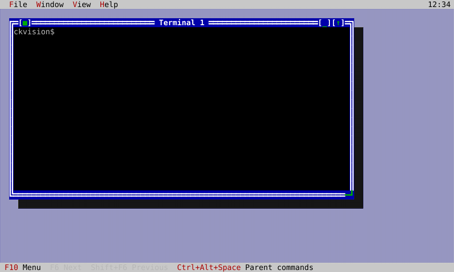
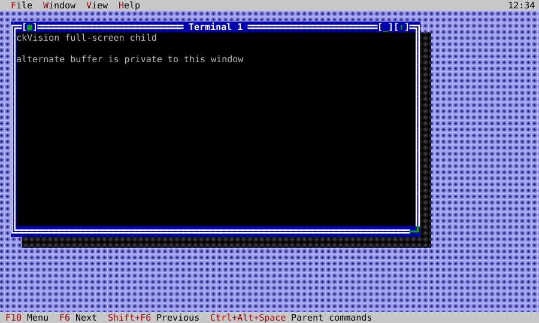
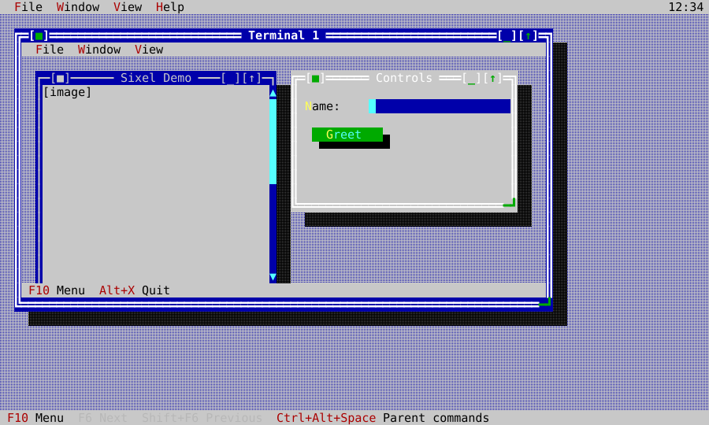
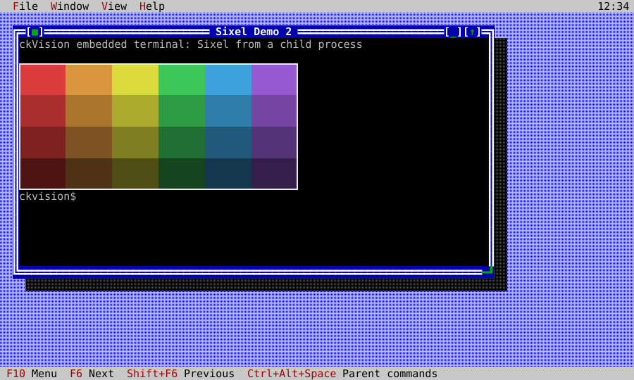
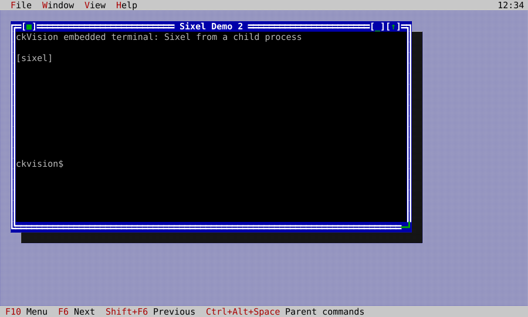
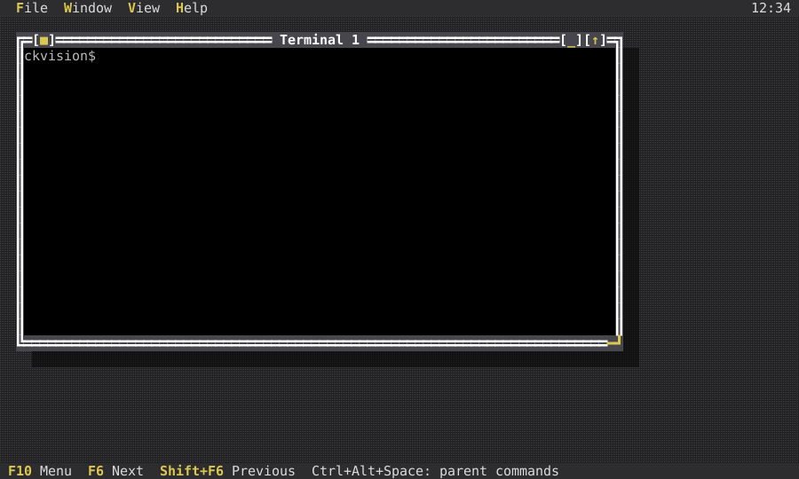
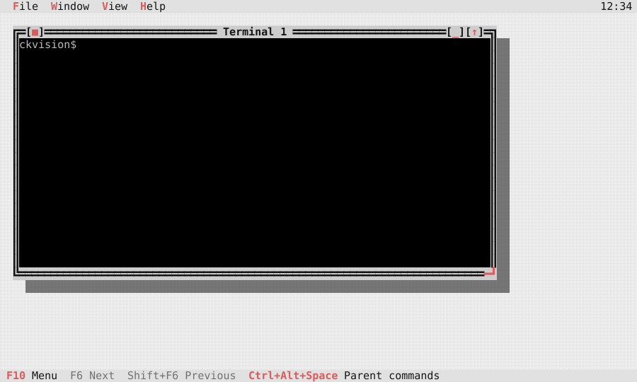
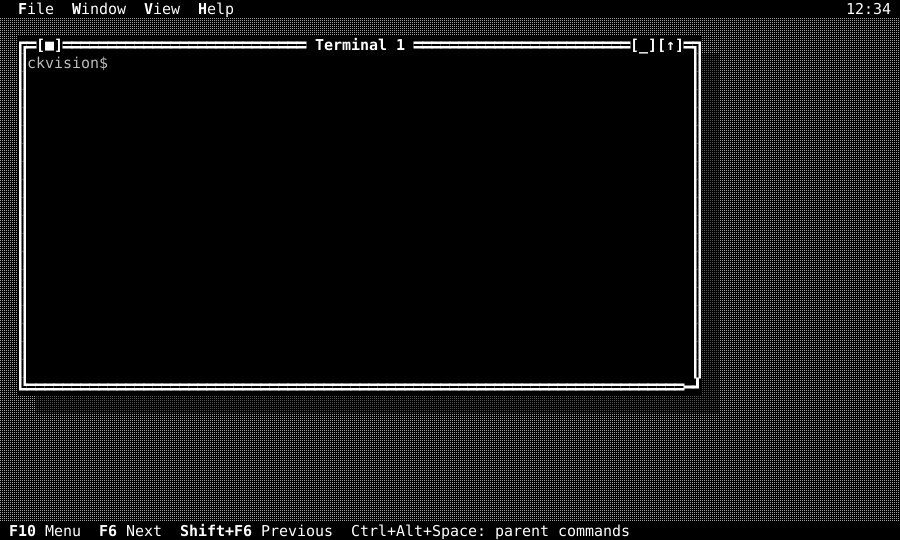
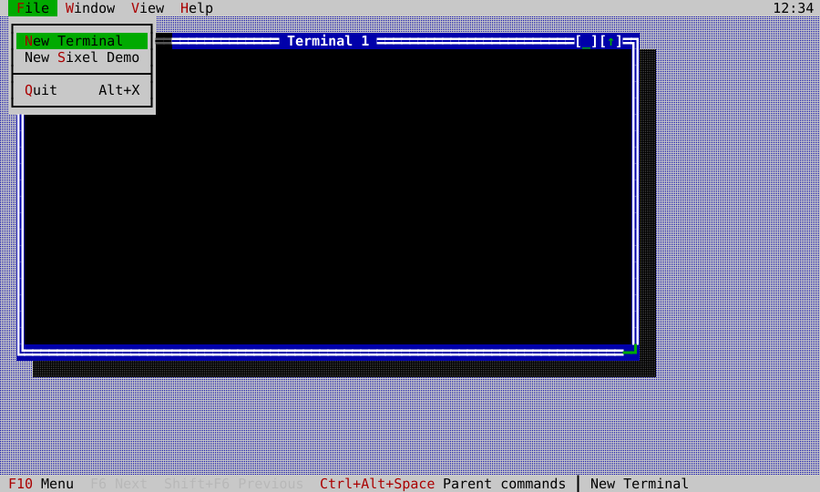

<!-- Copyright (c) 2026 C. Klukas. All rights reserved. -->

# Embedded terminal

`TerminalView` hosts an explicitly launched child terminal session inside a
normal ckVision window. It is not a pass-through to the parent terminal: the
child is connected to a private PTY (or ConPTY on the corresponding platform),
and ckVision alone presents the composed parent frame.

The runnable POSIX example is `ckvision_terminal`. It launches an interactive
`/bin/sh` child and reserves `Ctrl+Alt+Space` to return command focus to the
parent application. Choose **File → New Terminal** to create another isolated
shell window. `Ctrl+Alt+Space` moves focus to the parent menu bar without
sending that chord to the child. From there, **Window → Next/Previous**
(F6/Shift+F6) changes the active window, while **Window → Tile** and
**Window → Cascade** arrange every open terminal window. Shift-dragging in a
terminal selects visible cells and copies them to the application clipboard.
Choose **File → New Sixel Demo** to open a second private child that emits a
small Sixel sample before starting its interactive shell. With an outer Sixel
profile the sample is a clipped raster; with `NoGraphics` the same private
session uses its deterministic text fallback and emits no outer raster bytes.

| Initial shell | Full-screen alternate buffer | Nested child | Child Sixel on a graphics-capable outer terminal | Same child with no outer graphics |
|---|---|---|---|---|
|  |  |  |  |  |

The same shell path is exercised through every built-in presentation scheme,
so menu chrome and terminal content remain visible as the application theme
changes:

| Classic | Dark | Light | Mono |
|---|---|---|---|
|  |  |  |  |

The menu is regular ckVision chrome, including its opaque framed dropdown; it
does not ask a child terminal to paint any parent UI. Menu pointer activation
uses the normal press–drag–release contract: moving off an item cancels it,
moving back re-arms it, and dragging across the top-level labels switches the
open dropdown before release.



## Launching a contained child

```cpp
term::TerminalLaunchSpec shell = term::TerminalLaunchSpec::program("/bin/sh", {"-i"});
shell.profile = term::embedded_xterm_sixel_profile();
shell.environment = {{"TERM", "xterm-256color"}, {"COLORTERM", "truecolor"},
                     {"PATH", "/opt/homebrew/bin:/usr/local/bin:/usr/bin:/bin:/usr/sbin:/sbin"}};

term::TerminalSubsession& session = app.launch_terminal_subsession(std::move(shell));
auto terminal = std::make_unique<widgets::TerminalView>(session);
window->set_content(std::move(terminal));
```

`TerminalLaunchSpec` contains the executable, argv, working directory,
complete child environment, child capability profile, and exit policy. No shell
is inserted implicitly, and no environment or working directory is inferred
from the parent process.

`WaitForExit` requests a terminal hangup and waits for a graceful
process-group exit during teardown; `TerminateAfterGrace` adds a bounded grace
interval before escalating to process-group termination. Both policies close
the private PTY first. Use `TerminateAfterGrace` when teardown must remain
bounded even if a child deliberately ignores the hangup and termination
signals.

`Application` owns every launched session and drains each session through its
ordinary step loop with a fixed bounded budget. A `TerminalView` borrows the
session, so it must be detached before its owning application is destroyed.
Launch failures are reported in the child view as a stable diagnostic state;
they do not throw through the application's event loop or alter the parent's
terminal session.

The emulator also keeps a bounded child-output queue. If one adapter read is
larger than the parser work budget, its accepted tail is processed on later
steps instead of being silently discarded; bytes beyond the configured queue
limit produce a private limit diagnostic and are dropped at that boundary.

The embedded profile uses an explicit dark terminal default (black background,
light foreground), while SGR and truecolor updates remain child-local. The
POSIX demo also supplies the conventional Homebrew paths and 256-color/
truecolor environment markers, so installed tools such as `btop` resolve by
name without weakening the library's explicit-environment contract.

PageUp and PageDown navigate the bounded local scrollback. Shift-drag selects
the rows currently visible (including scrollback) and invokes the view's copy
callback; ordinary pointer events are forwarded only while the child has
enabled mouse tracking. The view emits legacy X10 or modern SGR mouse bytes
according to the child-selected encoding—it never guesses one protocol for
another.

The shipped profile supports the terminal modes needed by ordinary full-screen
applications: alternate buffer, DEC scrolling margins and origin mode,
index/reverse-index, application cursor keys, bracketed paste, focus reports,
and the declared cursor-status replies. These remain private PTY traffic; the
outer application's menus, window chrome, and `Ctrl+Alt+Space` escape chord
are always local.

For a full-screen smoke test, launch a child that uses the alternate buffer,
for example `printf '\033[?1049h\033[2J\033[Hfull-screen\033[?1049l'`, and
observe that the child returns to its primary buffer without changing the
parent menu or window chrome. The POSIX test suite runs this sequence through
a real PTY. A nested `ckvision_terminal` child and the Sixel demo are covered
by the separate PTY and pixel-containment tests described below.

## Nested ckVision applications

A ckVision application launched from the shell in a `TerminalView` is an
ordinary private child, not a second attachment to the parent terminal. For
example, after installing `ckvision_terminal` on the child shell's `PATH`, run
`ckvision_terminal` from that shell. Its own menus, alternate screen, input,
and resize handling operate on the private PTY while the parent application
continues to own the user's real terminal. The POSIX integration suite launches
a separately built ckVision child through this same path and verifies its
rendered frame is observed only by the parent session.

## Containment and policies

Child bytes are terminal-emulator input only. Cursor movement, OSC, DCS, and
unsupported controls modify private state or generate a child diagnostic; they
are never written to the outer terminal. The documented profile answers only
declared queries. OSC metadata is denied by default, and bracketed paste is
encoded only for the child session.

Child Sixel data is decoded into an RGBA raster snapshot. Parameterized Sixel
DCS commands are accepted, and graphics payloads have their own bounded limit
separate from ordinary CSI/OSC control strings so realistic images are not
mistaken for malformed control traffic. `TerminalView` adds
that snapshot through the normal scene painter, which supplies a text fallback
when outer graphics are unavailable. The normal compositor consequently owns
clipping, occlusion, resize damage, and removal when the child clears or exits.
The parser suite also decodes the original 256 KiB `snake.six` sample from
libsixel as a raw byte fixture; this guards against accidentally testing an
HTML download or a text-transcribed escape sequence instead of real Sixel.

## Building and checking

Configure and build the example with the standard project build:

```text
cmake -S . -B build
cmake --build build --target ckvision_terminal cvision_tests
ctest --test-dir build -R 'suite_test_(terminal_emulator|terminal_view|posix_terminal_subsession|terminal_app)|terminal_visual_capture' --output-on-failure
```

The Windows ConPTY adapter and its host matrix are a separate platform
acceptance requirement. A deterministic failure state is used on a build where
that adapter is unavailable; it is not a substitute for Windows evidence.
