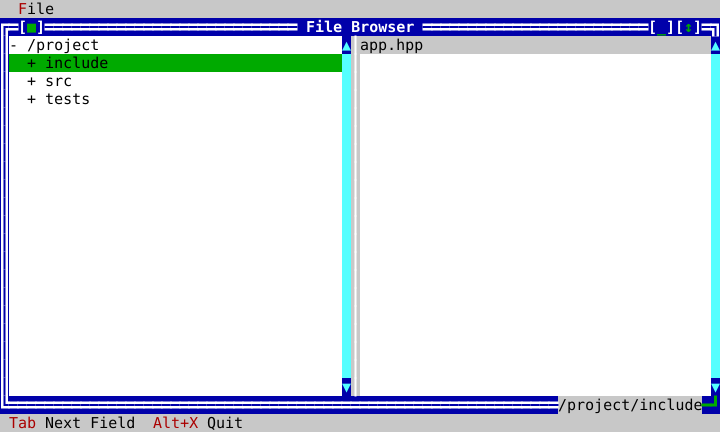

# Example applications

ckVision ships example applications the way tvision-sixel does —
small, complete programs that exercise the library end to end rather
than isolated widget demos. Each one lives under `examples/<name>/`
as a plain library-linkable static target (`<name>_app`) plus a thin
`main.cpp` that attaches it to a real terminal, so the exact same
object graph an interactive user runs is also what the headless test
suite drives — a documentation screenshot or a test failure both
describe the real application, never a simplified stand-in.

This page is generated documentation in the sense that its screenshots
are: they come from `tools/docgen/capture_gallery_screenshots`, which
builds an example app on a `HeadlessTerminal`, scripts a short
interaction, and renders the actually-composed frame to SVG via
`tools/docgen/frame_svg`. Regenerate them (and this page's HTML/PDF
output) with `tools/docgen/generate_docs.sh` — never hand-edit an SVG
under `docs/generated/`.

## Gallery (`examples/gallery`)

Gallery is the baseline example: a `Desktop` with a menu bar, a status
line, and two windows, driven entirely through the public `ui::View` /
`ui::Application` / `widgets::*` surface — nothing in `gallery_app.cpp`
reaches past those headers.

- **Menu bar** (`File`, `Window`) bound to real `ui::CommandRegistry`
  commands, activated via F10 (a bound command, not a MenuBar special
  case — see `include/cvision/widgets/menu.hpp`'s own file comment for
  why), with Esc restoring whatever was focused before activation.
- **Controls window**: a `Label` with a mnemonic, an `InputLine`, and a
  default `Button` — Tab traversal, typed text, and a click all reach
  their target through the ordinary focus/dispatch machinery
  (`ui::Application::dispatch`), the same path any application's own
  widgets use.
- **Sixel Demo window**: an `ImageView` showing a generated RGBA
  gradient, proving the raster path — `Painter::draw_image` through
  `scene::Compositor`'s occlusion slicing through `term::Presenter`'s
  Sixel encoder — actually reaches terminal bytes when the terminal
  capability advertises Sixel support.
- **Window shadows**: both windows cast a real, composited shadow
  (`widgets::Desktop::paint_children` interleaves
  `Painter::transform_style` with the z-ordered window paint — see
  that method's doc comment for why a naive whole-tree post-pass
  cannot get shadow occlusion right).
- **Move/resize**: `Window`'s own mouse handling supports dragging the
  title bar to move and dragging an edge/corner to resize, clamped to
  `Window`'s declared min/max size.

### What's verified, and how

Every claim above is backed by a real, green test — not just "the code
exists":

| Behavior | Test |
|---|---|
| Both windows render, with their titles | `test_gallery_smoke.cpp`: `the_gallery_renders_both_windows_titles_on_first_frame` |
| Menu bar + status line render | `the_menu_bar_and_status_line_both_render` |
| Typed keyboard input reaches the field and repaints | `typing_into_the_name_field_reaches_it_and_repaints` |
| F10 activates the menu bar via the command keymap | `f10_activates_the_menu_bar_via_the_command_keymap` |
| Esc after F10 restores prior focus | `escape_after_f10_returns_focus_to_where_it_was` |
| Alt+X quits via the documented shortcut | `alt_x_quits_via_the_status_lines_documented_shortcut` |
| A mouse click on Greet opens a message box with the typed name | `clicking_greet_opens_a_message_box_that_renders_the_typed_name` |
| Sixel bytes actually reach the terminal under full capabilities | `the_image_window_content_reaches_the_terminal_as_sixel_data_under_full_capabilities` |
| Window shadow cells are actually dimmed (exact expected style) | `tests/test_desktop.cpp`: `a_shadow_casting_windows_footprint_is_dimmed_on_the_desktop` |
| A higher window is never dimmed by a lower window's shadow | `a_higher_window_painted_afterward_is_not_dimmed_by_a_lower_windows_shadow` |

### Screenshots

Initial frame — menu bar, status line, both windows, the "Controls"
window's shadow visible under the "Sixel Demo" window's left edge:


After typing a name into the input field:


With the menu bar activated (F10):


### Running it yourself

```bash
cmake -B build -DCMAKE_BUILD_TYPE=Release
cmake --build build -j8
./build/examples/ckvision_gallery
```

Requires a real terminal (macOS Terminal.app, iTerm2, or any VT100+
terminal); Sixel image content additionally requires a Sixel-capable
terminal (iTerm2 with Sixel enabled, or a recent xterm build). On an
unsupported terminal, `ImageView`'s mandatory fallback (D-017) still
renders equivalent cell content in place of the image — never a blank
or broken region.

## File Browser (`examples/filebrowser`)

File Browser is the master-detail example: a folder-hierarchy
`TreeView` in one pane drives a `ListView` showing the selected
folder's contents in a second pane — a `TreeView::on_selection_changed`
callback is the entire wiring between them. It also demonstrates
`Desktop::dock_top`/`dock_bottom` (the menu bar and status line
reposition themselves automatically across a terminal resize, rather
than the application recomputing their bounds by hand) and
`Window::set_frame_overlay` (the selected directory's full path shown
live on the window's own bottom border — the general mechanism a text
editor would use for a "line: N, col: M" indicator).

- **Real disk access**: the interactive binary browses the actual
  filesystem via `term::PosixFileSystem` — previously the only
  `core::FileSystem` implementation anywhere in the repo was
  `MemoryFileSystem` (test-only), so no application could browse a
  real directory without writing that backend itself first.
- **Two-pane layout**: `ui::Row` with two `Expanding` items, the same
  layout container `make_directory_picker` already uses internally —
  no manual `set_bounds` bookkeeping for either pane.
- **Tree building**: `build_subtree()` in `filebrowser_app.cpp`
  recurses the injected `FileSystem` (directories only, depth-capped
  against symlink cycles on a real disk), the same pattern
  `make_directory_picker` uses — duplicated here deliberately so this
  example is copy-paste usable on its own, not dependent on that
  dialog's private helpers.
- **Focus traversal**: Tab switches between the tree and file-list
  panes — bound explicitly to a command in `FileBrowserApp`'s own
  constructor, since (by design) nothing in the library auto-binds Tab
  to focus traversal; an application that wants Tab for something else
  (a text editor inserting a literal tab) must be free to do that
  instead.

### What's verified, and how

| Behavior | Test |
|---|---|
| The tree starts with the root expanded and the file list showing its direct children | `test_filebrowser_smoke.cpp`: `the_tree_starts_with_root_selected_and_the_file_list_showing_its_direct_children` |
| Directories in the file list are suffixed with `/` | `directories_in_the_file_list_are_suffixed_with_a_trailing_slash` |
| Navigating the tree to a different folder updates the file list | `navigating_the_tree_to_a_different_folder_updates_the_file_list` |
| A nested subdirectory shows up suffixed too | `navigating_to_a_folder_with_a_nested_subdirectory_shows_it_suffixed` |
| Both panes, the menu bar, and the status line all render | `the_first_frame_renders_both_panes_and_the_menu_status_chrome` |
| The frame overlay shows the currently selected directory's full path, and updates live | `the_frame_overlay_shows_the_currently_selected_directorys_full_path` |
| Alt+X quits | `alt_x_quits` |
| Tab moves focus from the tree pane to the file-list pane | `tab_moves_focus_from_the_tree_to_the_file_list_pane` |

### Screenshots

Initial frame — the root folder expanded, its files and subfolders in
the right-hand pane, the current path shown on the window's own bottom
border:


After navigating to the `src` folder:



After navigating to the `include` folder — the file list and the
border's path indicator both updated:


### Running it yourself

```bash
cmake -B build -DCMAKE_BUILD_TYPE=Release
cmake --build build -j8
./build/examples/ckvision_filebrowser [path]   # defaults to the current directory
```

## Adding another example

1. `examples/<name>/<name>_app.{hpp,cpp}` — the object graph, taking
   `ui::Application&` in its constructor, exposing whatever accessors
   a headless test needs (see `gallery_app.hpp`'s own accessor list for
   the pattern).
2. `examples/<name>/main.cpp` — a `PosixTerminal` + `PosixClock` +
   `Application`, a `step()` loop, nothing else.
3. `examples/CMakeLists.txt` — one more `add_library(<name>_app
   STATIC ...)` / `add_executable(ckvision_<name> ...)` pair, following
   `gallery_app`'s.
4. `tests/test_<name>_smoke.cpp` — drive the SAME `<name>_app` target
   headlessly; this is what makes the example a tested artifact rather
   than a demo nobody runs in CI.
5. A section on this page, plus a `capture_<name>_screenshots` tool
   under `tools/docgen/` if the example's states are worth showing.
