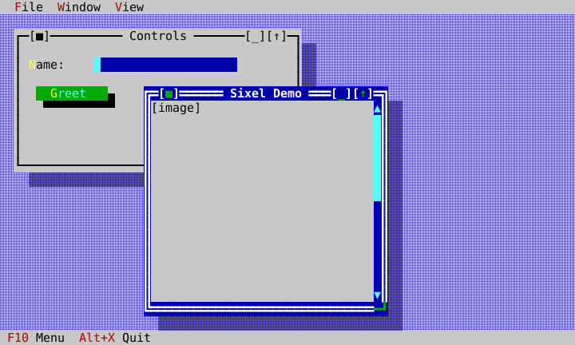
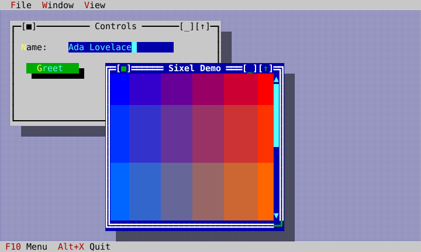
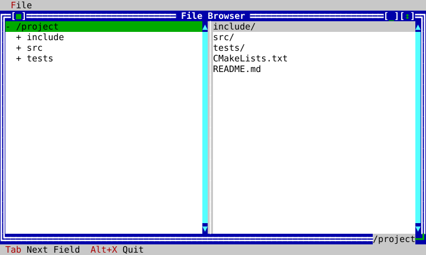
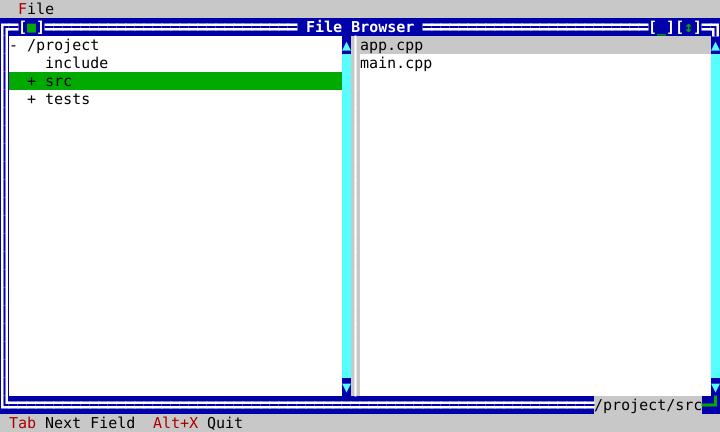

# Example applications

ckVision ships example applications the way tvision-sixel does —
small, complete programs that exercise the library end to end rather
than isolated widget demos. Each one lives under `examples/<name>/`
as a plain library-linkable static target (`<name>_app`) plus a thin
`main.cpp` that attaches it to a real terminal, so the exact same
object graph an interactive user runs is also what the headless test
suite drives — a documentation screenshot or a test failure both
describe the real application, never a simplified stand-in.

This page is generated documentation in the sense that its screenshots
are: they come from `tools/docgen/capture_gallery_screenshots`, which
builds an example app on a `HeadlessTerminal`, scripts a short
interaction, and renders the HeadlessTerminal virtual display to SVG via
`tools/docgen/frame_svg`. The virtual display consumes the exact VT/Sixel bytes
written by Presenter and independently reconstructs styled cells plus decoded
raster pixels; the screenshot path does not read the source `Image` directly.
Under the Sixel profile, Presenter first writes clean panel-colored blank cells
through the visible image region—never the `[image]` fallback text—and emits an
explicitly opaque Sixel raster. The SVG stores that decoded raster as one
lossless embedded bitmap, avoiding the hairline transparency artifacts that
adjacent per-pixel SVG rectangles can acquire during PDF conversion; equal
neighboring cell backgrounds are likewise merged so the surrounding panel
remains a clean solid color in PDF output. Recognized box-drawing glyphs are
rendered as cell-edge-aligned SVG geometry instead of font text, preventing
host-font metrics from introducing false gaps at frame corners.
Regenerate them (and this page's HTML/PDF
output) with `tools/docgen/generate_docs.sh` — never hand-edit an SVG
under `docs/generated/`.

The same Sixel and no-graphics images are also emitted as test artifacts. Run
`ctest --test-dir build -R gallery_visual_capture -V`; its output names the
SVGs under `build/test-artifacts/gallery/`. This visual test is separately
labelled `visual` and `artifact`, while the unit suite independently checks the
decoded pixel plane and raw protocol bytes. These artifacts are review aids;
WP-32A still owns the broader byte/hash-pinned pixel-golden matrix listed in
the corrective plan.

## Gallery (`examples/gallery`)

Gallery is the baseline example: a `Desktop` with a menu bar, a status
line, and two windows, driven entirely through the public `ui::View` /
`ui::Application` / `widgets::*` surface — nothing in `gallery_app.cpp`
reaches past those headers.

- **Menu bar** (`File`, `Window`) bound to real `ui::CommandRegistry`
  commands, activated via F10 (a bound command, not a MenuBar special
  case — see `include/cvision/widgets/menu.hpp`'s own file comment for
  why), with Esc restoring whatever was focused before activation.
- **Controls window**: a `Label` with a mnemonic, an `InputLine`, and a
  default `Button` — Tab traversal, typed text, and a click all reach
  their target through the ordinary focus/dispatch machinery
  (`ui::Application::dispatch`), the same path any application's own
  widgets use.
- **Sixel Demo window**: an `ImageView` showing a generated RGBA
  gradient, proving the raster path — `Painter::draw_image` through
  `scene::Compositor`'s occlusion slicing through `term::Presenter`'s
  Sixel encoder — actually reaches terminal bytes when the terminal
  capability advertises Sixel support.
- **Window shadows**: both windows cast a real, composited shadow
  (`widgets::Desktop::paint_children` interleaves
  `Painter::apply_shadow` with the z-ordered window paint — see
  that method's doc comment for why a naive whole-tree post-pass
  cannot get shadow occlusion right). Shadow coverage is binary: one
  or several overlapping casters apply the dim transform exactly once.
- **Move/resize**: `Window`'s own mouse handling supports dragging the
  title bar to move and dragging an edge/corner to resize, clamped to
  `Window`'s declared min/max size.

### What's verified, and how

Every claim above is backed by a real, green test — not just "the code
exists":

| Behavior | Test |
|---|---|
| Both windows render, with their titles | `test_gallery_smoke.cpp`: `the_gallery_renders_both_windows_titles_on_first_frame` |
| Menu bar + status line render | `the_menu_bar_and_status_line_both_render` |
| Typed keyboard input reaches the field and repaints | `typing_into_the_name_field_reaches_it_and_repaints` |
| F10 activates the menu bar via the command keymap | `f10_activates_the_menu_bar_via_the_command_keymap` |
| Esc after F10 restores prior focus | `escape_after_f10_returns_focus_to_where_it_was` |
| Alt+X quits via the documented shortcut | `alt_x_quits_via_the_status_lines_documented_shortcut` |
| A mouse click on Greet opens a message box with the typed name | `clicking_greet_opens_a_message_box_that_renders_the_typed_name` |
| Sixel bytes reach the terminal and decode into the virtual display's RGBA plane | `the_image_window_content_reaches_the_terminal_as_sixel_data_under_full_capabilities` |
| Sixel mode emits no `[image]` text and decodes to a solid, fully opaque 64×32 pixel rectangle | `the_image_window_content_reaches_the_terminal_as_sixel_data_under_full_capabilities`; `sixel_presentation_replaces_fallback_text_with_clean_background_cells` |
| The same frame has no raster pixels under NoGraphics | `the_same_gallery_frame_uses_only_the_cell_fallback_without_graphics` |
| Runtime Sixel → NoGraphics → Sixel changes remove and restore pixels without stale content | `runtime_graphics_capability_changes_remove_and_restore_virtual_raster_pixels` |
| Window shadow cells are actually dimmed (exact expected style) | `tests/test_desktop.cpp`: `a_shadow_casting_windows_footprint_is_dimmed_on_the_desktop` |
| A higher window is never dimmed by a lower window's shadow | `a_higher_window_painted_afterward_is_not_dimmed_by_a_lower_windows_shadow` |
| One or several overlapping window shadows remain one uniform shadow, including the lower-right footprint corner | `a_single_shadow_footprint_is_a_non_overlapping_union`; `overlapping_shadows_are_a_binary_union_not_cumulative_dimming`; `overlapping_window_shadows_dim_the_desktop_exactly_once` |
| A foreground frame crossing a lower window's frame stays a plain foreground border, never a merged junction | `a_foreground_window_frame_does_not_merge_with_a_background_window_frame`; `tests/golden/window_z_order_junction.dump` |

### Screenshots

Initial frame under the fixed-metrics Sixel profile — menu bar, status line,
both windows, and the decoded, fully opaque gradient emitted by Presenter over
clean panel-colored backing cells:


The identical initial application state under NoGraphics — no Sixel DCS is
emitted and ImageView's mandatory textual fallback remains visible:



After typing a name into the input field:



With the menu bar activated (F10):


### Running it yourself

```bash
cmake -B build -DCMAKE_BUILD_TYPE=Release
cmake --build build -j8
./build/examples/ckvision_gallery
```

Requires a real terminal (macOS Terminal.app, iTerm2, or any VT100+
terminal); Sixel image content additionally requires a Sixel-capable
terminal (iTerm2 with Sixel enabled, or a recent xterm build). On an
unsupported terminal, `ImageView`'s mandatory fallback (D-017) still
renders equivalent cell content in place of the image — never a blank
or broken region.

## File Browser (`examples/filebrowser`)

File Browser is the master-detail example: a folder-hierarchy
`TreeView` in one pane drives a `ListView` showing the selected
folder's contents in a second pane — a `TreeView::on_selection_changed`
callback (receiving the newly-selected `TreeNode&` directly, M10/
WP-22) is the entire wiring between them. It also demonstrates
`Desktop::dock_top`/`dock_bottom` (the menu bar and status line
reposition themselves automatically across a real terminal resize,
not just when the application recomputes their bounds by hand — a live
`ResizeEvent` enters through the terminal and `Application::step`; the
Application-owned root layout then applies `View::fills_root()`'s default to
the Desktop, whose own `on_resized()` repins both docks and reclamps every
window. See `tests/test_m8_integration.cpp` and
`tests/test_root_resize_golden.cpp`.) and `Window::add_frame_overlay`
(the selected directory's full path shown live on the window's own
bottom border — the general mechanism a text editor would use for a
"line: N, col: M" indicator; M10/WP-20's plural, positioned overlays
replace this app's original single-slot `set_frame_overlay` call with
no change in the app's own observable behavior).

- **Real disk access**: the interactive binary browses the actual
  filesystem via `term::PosixFileSystem` — previously the only
  `core::FileSystem` implementation anywhere in the repo was
  `MemoryFileSystem` (test-only), so no application could browse a
  real directory without writing that backend itself first.
- **Two-pane layout**: `widgets::Splitter` (M10/WP-19) holding the tree
  and file-list panes, starting at an exact 50/50 split — the same
  ratio the app's original `ui::Row` with two `Expanding` items gave,
  now keyboard-adjustable (Tab to the Splitter, then Left/Right) rather
  than fixed.
- **Lazy tree population** (M10/WP-22): only the root's own direct
  subdirectories are listed eagerly, so it can start expanded; every
  deeper level is listed on demand the first time the user expands it,
  via `TreeView::on_expand_request`. `populate_children()` in
  `filebrowser_app.cpp` is the one function both the root's initial
  listing and every later lazy expansion call — no depth cap needed,
  since nothing is ever recursed into ahead of the user actually
  asking to see it. Each node's own full path lives in
  `TreeNode::user_data` (a `std::any` holding a `std::string`),
  replacing what used to be a separate sidecar
  `std::unordered_map<const TreeNode*, std::string>`.
- **Focus traversal**: Tab cycles through the tree pane, the Splitter
  (M10/WP-19 — Left/Right there adjusts the pane split), and the file-
  list pane — the library's own default keymap (DECISIONS.md D-029, M9/
  WP-13), with nothing bound explicitly in `FileBrowserApp`'s own
  constructor. An application that wants Tab for something else (a
  text editor inserting a literal tab) keeps that freedom, because a
  focused view consuming Tab already preempts the keymap by routing
  order.

### What's verified, and how

| Behavior | Test |
|---|---|
| The tree starts with the root expanded and the file list showing its direct children | `test_filebrowser_smoke.cpp`: `the_tree_starts_with_root_selected_and_the_file_list_showing_its_direct_children` |
| Directories in the file list are suffixed with `/` | `directories_in_the_file_list_are_suffixed_with_a_trailing_slash` |
| Navigating the tree to a different folder updates the file list | `navigating_the_tree_to_a_different_folder_updates_the_file_list` |
| A nested subdirectory shows up suffixed too | `navigating_to_a_folder_with_a_nested_subdirectory_shows_it_suffixed` |
| Both panes, the menu bar, and the status line all render | `the_first_frame_renders_both_panes_and_the_menu_status_chrome` |
| The frame overlay shows the currently selected directory's full path, and updates live | `the_frame_overlay_shows_the_currently_selected_directorys_full_path` |
| Alt+X quits | `alt_x_quits` |
| Tab moves focus from the tree pane to the file-list pane | `tab_moves_focus_from_the_tree_to_the_file_list_pane` |
| The tree and file-list panes start at an even 50/50 split | `the_tree_and_file_list_panes_start_at_an_even_50_50_split` |
| The panes are children of a Splitter positioned between them | `the_panes_are_children_of_a_splitter_positioned_between_them` |
| Adjusting the Splitter resizes both panes and keeps them contiguous | `adjusting_the_splitter_resizes_both_panes_and_keeps_them_contiguous` |
| A directory never expanded starts with unknown, unpopulated tree children | `a_directory_never_expanded_starts_with_unknown_unpopulated_tree_children` |
| Expanding a never-listed directory populates it on demand through the filesystem | `expanding_a_never_listed_directory_populates_it_on_demand_through_the_filesystem` |
| A lazily populated child is itself still lazy until expanded | `a_lazily_populated_child_is_itself_still_lazy_until_expanded` |

### Screenshots

Initial frame — the root folder expanded, its files and subfolders in
the right-hand pane, the current path shown on the window's own bottom
border:



After navigating to the `src` folder:


After navigating to the `include` folder — the file list and the
border's path indicator both updated:



### Running it yourself

```bash
cmake -B build -DCMAKE_BUILD_TYPE=Release
cmake --build build -j8
./build/examples/ckvision_filebrowser [path]   # defaults to the current directory
```

## Adding another example

1. `examples/<name>/<name>_app.{hpp,cpp}` — the object graph, taking
   `ui::Application&` in its constructor, exposing whatever accessors
   a headless test needs (see `gallery_app.hpp`'s own accessor list for
   the pattern).
2. `examples/<name>/main.cpp` — a `PosixTerminal` + `PosixClock` +
   `Application`, a `step()` loop, nothing else.
3. `examples/CMakeLists.txt` — one more `add_library(<name>_app
   STATIC ...)` / `add_executable(ckvision_<name> ...)` pair, following
   `gallery_app`'s.
4. `tests/test_<name>_smoke.cpp` — drive the SAME `<name>_app` target
   headlessly; this is what makes the example a tested artifact rather
   than a demo nobody runs in CI.
5. A section on this page, plus a `capture_<name>_screenshots` tool
   under `tools/docgen/` if the example's states are worth showing.
