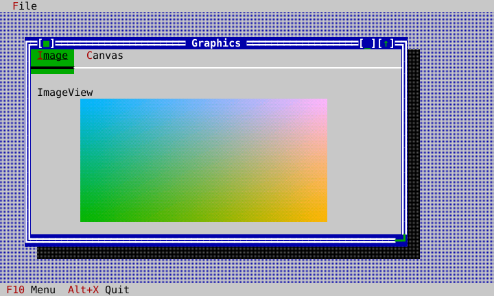
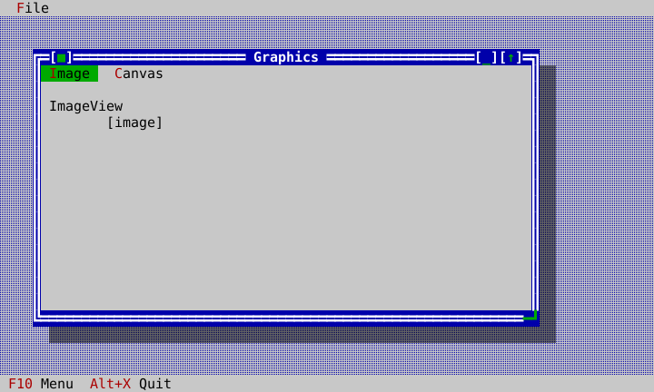
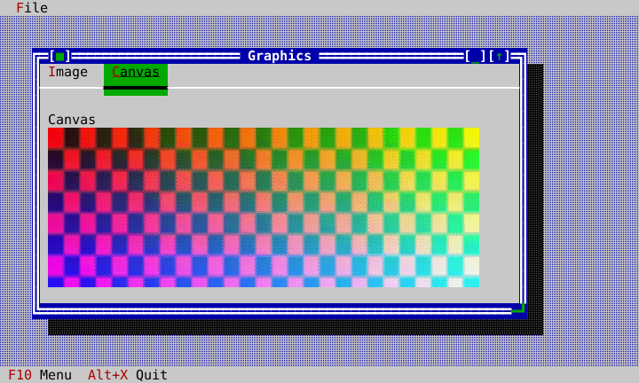
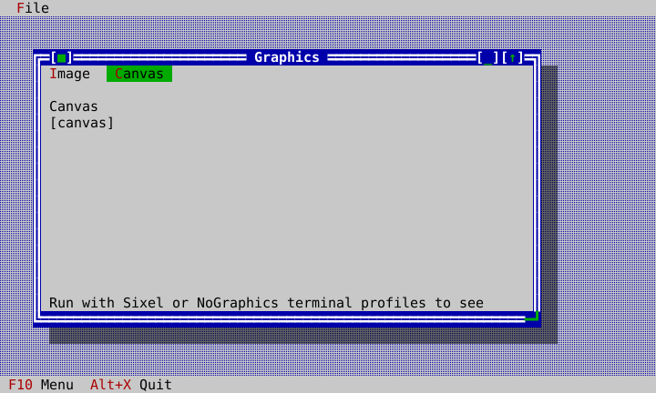

# Graphics

`ImageView` presents an immutable `Image`; `Canvas` owns a raster and asks its
draw callback to render it. Both are ordinary views, so they can live in tabs,
windows, layouts, and Desktop surfaces. On a terminal with Sixel capability the
Presenter emits a raster overlay. With no graphics capability it renders the
documented cell fallback instead of a blank area.

| Sixel ImageView | No-graphics ImageView |
|---|---|
|  |  |

The same app gives each view a click callback and switches pages through a
normal `TabControl`:

<!-- ckvision-snippet source="examples/graphics/graphics_app.cpp" lines="43-98" -->
```cpp

    auto status = std::make_unique<widgets::StatusLine>();
    status->set_items({widgets::StatusLineItem{widgets::CommandPresentation{ui::std_commands::kMenu}},
                       widgets::StatusLineItem{widgets::CommandPresentation{ui::std_commands::kQuit}}});
    desktop_->dock_bottom(std::move(status));
}

void GraphicsApp::build_window() {
    demo_image_ = make_demo_image();

    auto window = std::make_unique<widgets::Window>("Graphics");
    window->set_bounds(Rect{4, 3, 62, 17});
    auto tabs = std::make_unique<widgets::TabControl>();
    tabs->set_bounds(Rect{0, 0, 60, 15});
    tabs_ = tabs.get();

    auto image_page = std::make_unique<ui::View>();

    auto image_label = std::make_unique<widgets::Label>("ImageView");
    image_label->set_bounds(Rect{1, 1, 16, 1});
    image_page->add_child(std::move(image_label));

    auto image = std::make_unique<widgets::ImageView>();
    image->set_bounds(Rect{1, 2, 54, 10});
    image->set_image(demo_image_);
    image->on_click = [this](const MouseEvent&) { ++image_clicks_; };
    image_view_ = image.get();
    image_page->add_child(std::move(image));

    auto canvas_page = std::make_unique<ui::View>();

    auto canvas_label = std::make_unique<widgets::Label>("Canvas");
    canvas_label->set_bounds(Rect{1, 1, 16, 1});
    canvas_page->add_child(std::move(canvas_label));

    auto canvas = std::make_unique<widgets::Canvas>();
    canvas->set_bounds(Rect{1, 2, 54, 10});
    canvas->set_cell_metrics(Size{2, 3});
    canvas->set_draw_callback([](Image& target) {
        for (int y = 0; y < target.height(); ++y) {
            for (int x = 0; x < target.width(); ++x) {
                const bool stripe = ((x / 4) + (y / 4)) % 2 == 0;
                target.set_pixel(x, y,
                                 Image::Rgba{stripe ? std::uint8_t{240} : std::uint8_t{40},
                                             std::uint8_t(x * 255 / (target.width() > 1 ? target.width() - 1 : 1)),
                                             std::uint8_t(y * 255 / (target.height() > 1 ? target.height() - 1 : 1)),
                                             255});
            }
        }
    });
    canvas->on_click = [this](const MouseEvent&) { ++canvas_clicks_; };
    canvas_ = canvas.get();
    canvas_page->add_child(std::move(canvas));

    auto note = std::make_unique<widgets::StaticText>(
        "Run with Sixel or NoGraphics terminal profiles to see raster output and fallback.");
```
<!-- /ckvision-snippet -->

| Sixel Canvas | No-graphics Canvas |
|---|---|
|  |  |

For a Canvas, set cell metrics before drawing so cell and raster geometry agree.
The callback receives its target image; do not bypass the view to write terminal
protocol directly. Mouse events reach `on_click`; pixel coordinates are
available only when the injected terminal capability advertises pixel mouse.
The HeadlessTerminal captures above test both Sixel and no-graphics profiles
through Presenter bytes and a virtual display, rather than reading image memory.
