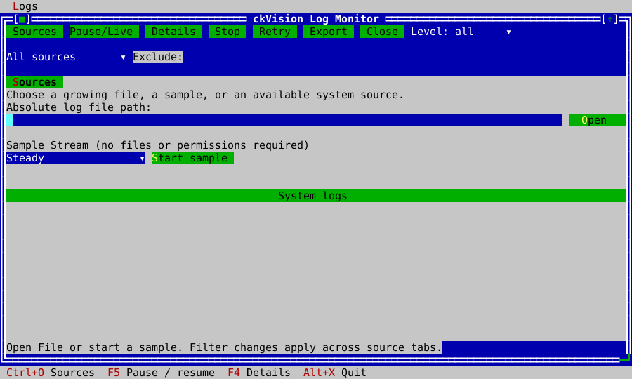
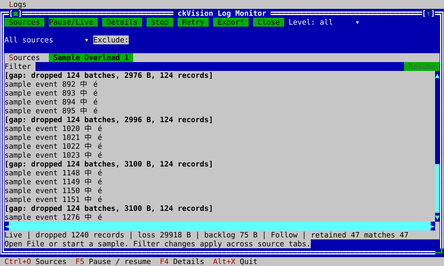
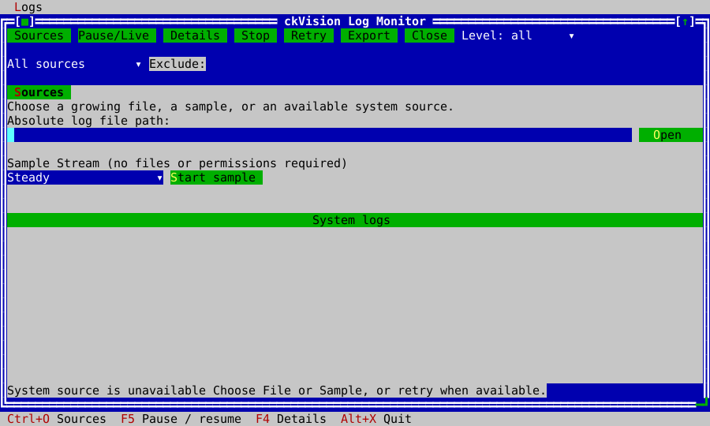
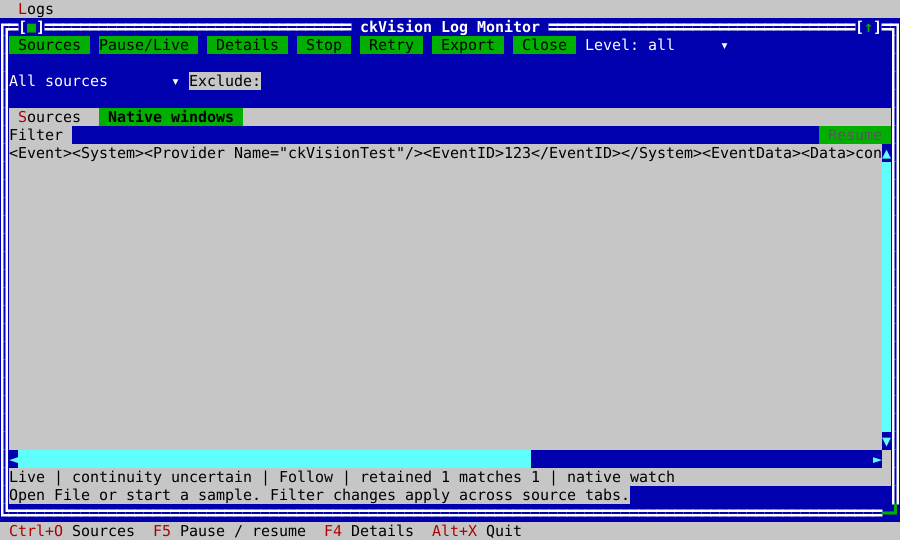

<!-- Copyright (c) 2026 C. Klukas. All rights reserved. -->
<!-- SPDX-License-Identifier: MIT -->

# Log Monitor example

Build with examples enabled and run `ckvision_logmonitor`. The same portable
graph builds on macOS, Linux and Windows. It starts at Sources, with Open File,
Sample Stream and an application-supplied system-source catalog. Ordinary user
permissions suffice for File/Sample. Native entries describe available system
subscriptions; unavailable entries explain recovery options. Source permission
is checked when opening, without automatic elevation.

Enter an absolute file path and choose Open. The shipped native file service
and LogFollower read a bounded recent tail, then follow the pathname through
supported append/rotation/truncation. Each named tab owns retained history and
its follow/inspect position. Source failures retain the view; Retry reopens a
bounded recent tail in a new generation. Earlier retained generations remain
identified separately. Stop stops intake; Close retires the source and tab.

The panel's Filter field applies a shared include literal across source tabs.
Exclude, severity and source controls add explicit predicates. Unknown severity
stays unknown for ordinary files. Find is separate: Ctrl+F, F3 and Shift+F3
search the published eligible entries. Query rebuild/backlog status stays
visible. Sources (Ctrl+O), Pause/Live (F5), Details (F4), Stop (F6), Retry (F7),
Copy selection (Ctrl+C), Export filtered retained (Ctrl+E) and Close source
(Ctrl+W) are ordinary commands under Logs. Narrow layouts retain the menu paths.
Wrap lines is a menu choice. Scrolling up pauses presentation while intake
continues; Resume/End returns to the tail with unread accounting.

Samples use supplied monotonic time and no disk files or helper permissions.
Steady emits one record per 100 ms, Burst 32, and Overload 128 into a four-slot
DropOldest queue. Loss is a visible gap, distinct from retention eviction.
Rotation/Truncation use an injected deterministic range/identity adapter and
the real LogFollower. Their notifications, offsets and generation transitions
follow the same library contracts as a native file. No generated source chooses
a hidden temporary directory.

Details inspect the selected retained identity, or the current live/paused
entry. They show source, generation/sequence, observed level, source timestamp
or unknown, fields, safe display text, escaped raw bytes and three neighbors
on each side. Context does not alter filtering. Copy uses grapheme-safe selected
display text and the injected clipboard.

Export offers selected **whole records touched by the selection** or the
current **published filter's retained window**. It does not claim durable/full
source history. The snapshot records source/query revision and include/exclude/
severity/source scope. While copying up to 128 records/64 KiB per turn, only
that source's ingress is held; other sources and input continue. The 2 MiB
snapshot limit rejects excess rather than silently exporting a partial result.
Intake resumes before worker file I/O. Atomic create-only writing preserves
existing filenames; choose another name after conflict. Snapshot construction
and write completion are shown separately. Changing the filter afterwards does
not change an already captured export.

The native composition constructs file and export workers outside dispatch.
Open/reopen requests are admitted in the outer loop, then allocate bounded
models/followers outside event dispatch. The application has eight source slots,
2048 records and a 1 MiB arena per model, with an 8192-byte raw-record limit.
Source publication, matching and panel refresh use LogController's yielding
deadlines. Bounded Application frame delivery coalesces slow host output while
input continues. Idle lanes need no controller poll timer; native file
reconciliation remains explicit. Export completion wakes through the activity
latch, with a 50 ms polling fallback for injected writers without a wake.

The example library injects FileSystem, LogFileService, ExportWriter, LogActivity
and NativeSourceDescriptor/StreamFeed. OS discovery/schema mapping belongs to
the catalog/feed, not widgets. The view tree dies before borrowed source models,
and native workers join only after the controller/receivers retire. See
[Live logs](live-logs.md) and [private process streams](process-helpers.md#continuous-process-output)
for bounds, ownership, source continuity and physical-visibility distinctions.

The headless graph has sixteen pinned states and workflow tests, plus real native
file/atomic-export checks. Full three-platform, installed-client, performance
and actual native-window acceptance remains the WP-84 matrix. Headless frames
alone are not evidence of what a user's running terminal displays.

## Native source choices

| Host | Source | Startup and continuity | Metadata |
|---|---|---|---|
| macOS | Capability-checked `/usr/bin/log stream` with NDJSON, info/default levels, log event type | Live only; debug/activity/trace and historical events are outside this subscription; retry may leave a gap | Process path/PID, subsystem/category, message type, explicit-offset source timestamp and message |
| Linux | Discovered absolute journalctl, accessible or user journal | Most recent 100 matching accessible records then live in one invocation; retries may repeat recent history or miss older events | Unit, process/PID, priority, realtime source timestamp, identifier, cursor and message |
| Windows | Application/System plus enabled operational channels from a bounded catalog | Future-only by default; an explicit supplied bookmark requests strict start-after semantics; stale state fails visibly | Channel/provider, event/record ID, source timestamp, bookmark, rendered-message prefix or native render error |

Ordinary files keep unknown severity/timestamps unless a producer supplies
metadata. Native JSON/XML remains the raw record, preserving unknown fields and
redaction under the model's retention/record limits. Selected metadata scalars
are bounded UTF-8 prefixes. Source diagnostics distinguish metadata clipping,
malformed/oversized envelopes, private helper stderr, native errors, nonzero
helper exit, denied channels and stale resume state. Details remain available
even before any entry is retained. Missing Windows message resources preserve
XML data plus a render error rather than dropping the event.

`NativeLogSourceOptions` belongs to the example composition. Its Apple process
name/PID, journal identifier, Windows channel and Windows bookmark are explicit
subscription limits/resume choices. Local filters cannot recover excluded input.
The app-boundary catalog probes capabilities before dispatch; callbacks borrow
NativeLogSources, which must enclose all feeds. Discovery is bounded and recorded
at startup; restart discovery after installing a helper or enabling a channel.
File/Sample remain usable when a native source is unavailable.

POSIX adapters frame at most 16 KiB/four envelopes per supplied-time turn, with a
64 KiB envelope, depth 16 and eight 384-byte metadata prefixes. Raw pipes
backpressure; eight structured publications use DropOldest with visible shipped
gaps. Private stderr retains only its first 1024 bytes. Windows prestarts eight
workers, renders bounded XML/system/message/bookmark buffers and waits on native
subscription/cancellation signals while quiet. A one-entry publisher cache per
worker avoids reopening metadata for every same-provider event. Feed retirement
requests cancellation; service shutdown joins outside dispatch.

The current focused evidence includes portable replay on macOS/Linux and tagged
real macOS/Linux events through the same headless app graph. Native Windows
compilation/event validation, thread/resource stress, actual native windows and
measured performance remain pending. Replay is not native subscription evidence.

Derivation follows installed Apple `log help stream`, systemd's
[journalctl manual](https://www.freedesktop.org/software/systemd/man/255/journalctl.html),
[RFC 8259](https://www.rfc-editor.org/rfc/rfc8259), and Microsoft's
[event subscriptions](https://learn.microsoft.com/en-us/windows/win32/wes/subscribing-to-events),
[event rendering](https://learn.microsoft.com/en-us/windows/win32/api/winevt/nf-winevt-evtrender)
and [bookmark contracts](https://learn.microsoft.com/en-us/windows/win32/wes/bookmarking-events).

## Tested documentation frames

These figures are generated from the same application scenarios as the pinned
goldens, checked for exact golden equality before SVG writing. They show
headless decoded VT frames, checked against capability-projected composition; they do not establish a native terminal window.

## Additional tested workflow frames

| Workflow | Tested frame |
|---|---|
| Live tail | [Frame](generated/screenshots/logmonitor-live.svg) |
| Paused inspection | [Frame](generated/screenshots/logmonitor-paused.svg) |
| Filtered records | [Frame](generated/screenshots/logmonitor-filtered.svg) |
| Record details | [Frame](generated/screenshots/logmonitor-details.svg) |
| Export scope | [Frame](generated/screenshots/logmonitor-export.svg) |
| File failure | [Frame](generated/screenshots/logmonitor-file-error.svg) |
| Narrow viewport | [Frame](generated/screenshots/logmonitor-narrow.svg) |
| Apple metadata | [Frame](generated/screenshots/logmonitor-native-apple.svg) |
| Journal metadata | [Frame](generated/screenshots/logmonitor-native-journal.svg) |
| Windows denied channel | [Frame](generated/screenshots/logmonitor-native-windows-denied.svg) |
| Windows stale resume state | [Frame](generated/screenshots/logmonitor-native-windows-stale.svg) |
| Windows missing message resources | [Frame](generated/screenshots/logmonitor-native-windows-missing-message.svg) |
