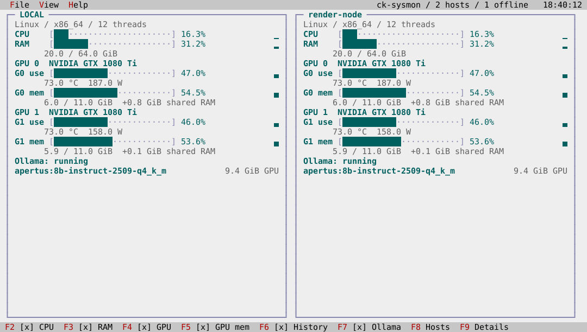
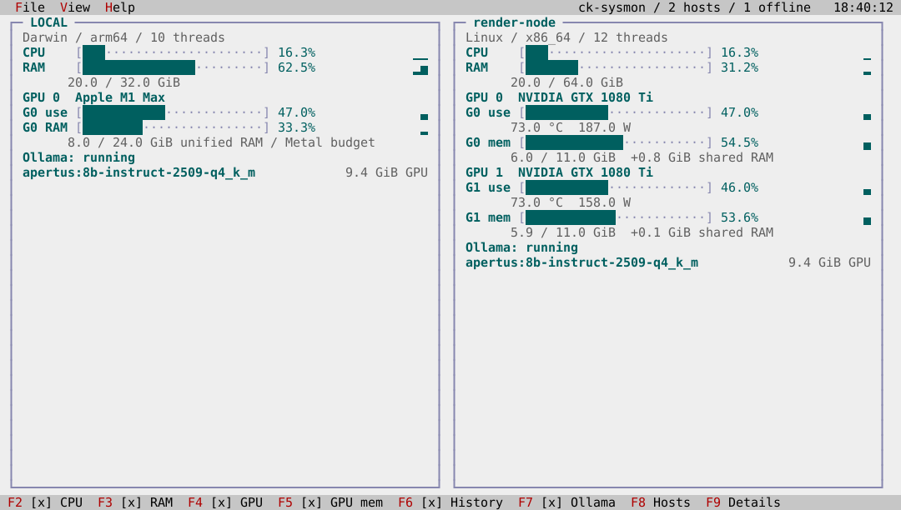
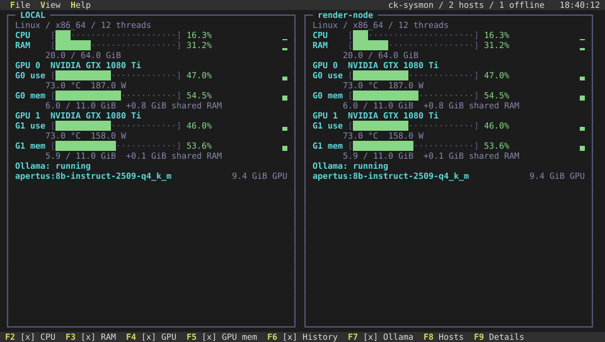
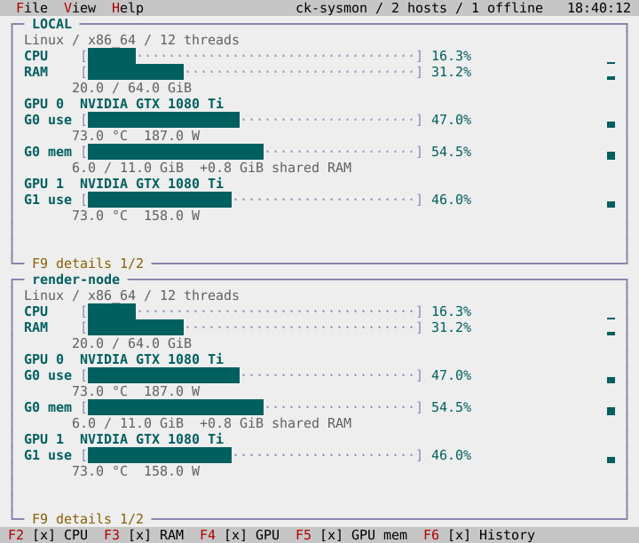
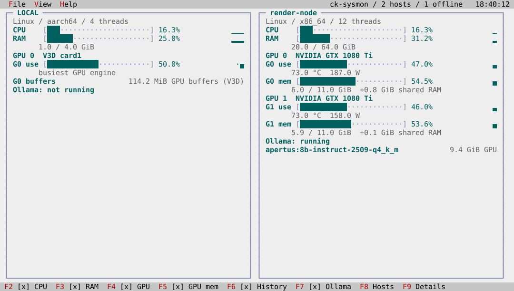

# ck-sysmon: desktop system monitor

`ck-sysmon` is a separate application from the SysInfo benchmark demo. It draws
resource charts directly on the desktop background, without monitor windows or
raster graphics. The local machine starts selected and can be unchecked in View. With all hosts
unchecked, the desktop shows a prompt to select hosts. The View menu lists concrete
SSH destinations from the user's and system's OpenSSH configuration, including
included files. Discovery includes `Host` entries and positive literal names in
`Match host` and `Match originalhost` criteria; it does not evaluate Match conditions
or infer usernames from them. OpenSSH resolves authentication for each destination.
A successful passwordless connection selects a host by default;
a failed connection leaves a disabled, unchecked item with an explanation.
Reader selections survive subsequent refreshes and connection recovery.

Build and run the `ck_sysmon` CMake target. Its output is
`<build>/examples/ck-sysmon` (`ck-sysmon.exe` on Windows). It uses the same native
terminal backend as the other examples. File / Exit closes it, Help / About
explains the display, and the clock at the menu bar's right edge drops down a
calendar. The host injects local time and today's date; neither the application
layout nor the widgets read a wall clock.

| Control | Effect |
|---|---|
| F2 / CPU | Toggle aggregate CPU utilization |
| F3 / RAM | Toggle occupied physical memory |
| F4 / GPU | Toggle GPU utilization, temperature and power |
| F5 / GPU memory | Toggle dedicated GPU memory and shared system RAM |
| F6 / History | Toggle bounded resource histories |
| F7 / Ollama | Toggle loaded Ollama models and GPU allocations |
| F8 / Next hosts | Page selected host cards |
| F9 / Next details | Page resource and model rows within cards |
| Ctrl+R / Refresh hosts | Recheck all discovered aliases immediately |
| Ctrl+D / Calendar | Open the menu-bar calendar from the keyboard |

The system line reports the logical processor (thread) count alongside the
aggregate CPU bar; individual core bars are not displayed.

The status line's toggles are clickable and show their state. The same commands
are available under View / Metrics when the terminal is too narrow to show them
all. Each horizontal bar has a fixed 0–100% scale; each vertical block history
runs from oldest to newest, retaining up to 60 samples. Histories count samples,
not exact seconds: local polling is requested once per second; remote polling
is limited by command duration and duplicate requests coalesce. Unselected and
unavailable hosts are rechecked every 15 seconds. Missing samples create gaps.
Cards choose their column count from the available terminal width, then page
hosts and details rather than silently dropping devices. Long labels are
clipped to their available cell width. Model allocations come from Ollama's
`size_vram`; these are model allocations, not a second GPU measurement to add to
VRAM usage.

## Screenshots

These deterministic screenshots use fixed telemetry through the real application,
Presenter and independently decoded terminal. They are regenerated and checked
in CI, including bright/dark palettes and a vertically stacked layout.









## Install packages

The `packages` GitHub workflow builds Linux x86_64 and ARM64 DEB/RPM/TGZ,
macOS Apple Silicon and Intel TGZ plus a verified Homebrew formula, and Windows
x64 and ARM64 ZIP/MSI. Successful main builds retain CI artifacts; matching
version tags publish them as release assets. The self-hosted primary ARM64
lane builds Linux DEB/RPM/TGZ offline and retains the same checksums and tests.
ckVision packages contain the framework library, public headers, CMake exports,
example sources and all example programs supported on the target platform,
including ck-sysmon.

macOS distributions require macOS26 or newer. Its standard library provides the
floating-point `std::from_chars` operations required by the framework. Both Mac
package architectures are built and tested against that deployment baseline.

Verify the adjacent `.sha256` file before installation. For Debian/Raspberry Pi,
download the native-architecture DEB and run `sudo apt-get install ./ckvision_*.deb`.
The packages built on Ubuntu24.04 support its runtime baseline; the self-hosted
Debian13 ARM64 package targets Debian13, including the tested Raspberry Pi and
uConsole. Install a Windows MSI for the machine's architecture by opening it,
or use `msiexec /i PACKAGE.msi`. It installs for the current user, registers a
reversible user PATH entry and needs no separate Visual C++ runtime. ZIPs are
portable alternatives; add their `bin` directory to PATH yourself.
For development, use `find_package(ckvision CONFIG REQUIRED)` and link
`ckvision::cvision`. Set `CMAKE_PREFIX_PATH` to the installation prefix when
needed. Windows SDK packages use the static MSVC runtime: configure consumer
Release builds with `-DCMAKE_MSVC_RUNTIME_LIBRARY=MultiThreaded`.

On macOS, download the generated `ckvision.rb` formula from the release or
verified CI artifact. Register a local package tap once, then install it:

```sh
brew tap-new --no-git ckvision/packages
cp ckvision.rb "$(brew --repository ckvision/packages)/Formula/ckvision.rb"
brew install ckvision/packages/ckvision
brew test ckvision/packages/ckvision
```

On Intel Macs, Homebrew may have no prebuilt CMake package. Install that build
dependency from source with `brew install --build-from-source cmake` before
installing ckVision. The Intel CI lane verifies this installation path.

The formula pins an immutable source archive and its SHA256 checksum, builds
all supported example programs and installs the complete framework SDK,
public headers, CMake exports and example sources. Package removal leaves
user settings intact. `ck-sysmon --version` verifies the installed release.
The build respects Homebrew's job limit; set `HOMEBREW_MAKE_JOBS` when a smaller
build should leave resources available for other work.

## Appearance and saved options

Standard (bright) is the default. View / Theme switches between Standard and Dark.
The shell, calendar and About dialog follow the selected theme. Chart surfaces,
frames, headings, histories and load accents switch together; Standard uses a
light desktop with darker chart colors. The application name, host count and host
page appear in the menu bar before the clock and shorten when space is tight.
The status line is the only footer. Panels fill the space between the two bars,
without blank rows before, between or after vertically stacked panels. Ollama
uses one status row and one row per model, with its GPU allocation on that row.

Theme, all six metric toggles, and desired selections for local and configured
remote hosts are saved after each option change and restored on relaunch.
A temporary SSH failure does not overwrite a saved selection. New hosts default
to selected when reachable. Navigation pages and open dialogs are session state.
The versioned text file is written atomically, with conflict detection; errors
appear on the desktop instead of silently losing preferences. No credentials,
telemetry or model names are stored.

| Platform | Settings file |
|---|---|
| macOS | `~/Library/Application Support/ckvision/ck-sysmon.settings` |
| Linux | `$XDG_CONFIG_HOME/ckvision/ck-sysmon.settings`, or `~/.config/ckvision/ck-sysmon.settings` |
| Windows | `%APPDATA%\ckvision\ck-sysmon.settings` |

Missing settings use defaults. Invalid settings are reported and use defaults;
a subsequent option change replaces them. Concurrent changes are reported and
require a relaunch to reload the file. The CLI sample modes do not touch settings.

## Collection and installation

No target installation is required. OpenSSH uses the target's existing User,
Port, IdentityFile, ProxyJump and other configuration. Connections use batch
mode, no password prompt, strict known-host verification, no forwarding, and
bounded connect/idle timeouts. The application does not install a helper, enroll
host keys, start Ollama, or change authentication settings. Wildcard Host
patterns are not destinations and are not expanded into guessed hostnames.

An installed `ck-sysmon --sample` on the remote account's PATH is preferred. It
emits versioned, bounded text using our C++ collectors. Otherwise the monitor
uses fixed read-only queries against existing system tools. Aliases are passed
as argument data; they never become remote script text. SSH work runs on two
workers and local collection has its own worker, so a slow remote does not stall
local charts, menus or the clock. Initial detection may take several SSH calls.
A process/query failure removes the previous measurements instead of displaying
stale values. A successful SSH connection with an unsupported response remains
selectable and explains the unavailable metrics.

| Host | Native C++ collector | Tool fallback |
|---|---|---|
| Linux | `/proc/stat`, `/proc/meminfo`, DRM sysfs; optional dynamic NVML | `/proc`, `/sys`, awk, optional `nvidia-smi` and curl |
| macOS | Mach CPU/VM counters, sysctl, Metal identity + optional IOKit GPU counters | top, vm_stat, sysctl, optional curl |
| Windows | GetSystemTimes, GlobalMemoryStatusEx, DXGI, PDH; optional dynamic NVML | PowerShell CIM, optional `nvidia-smi` |

Windows native GPU memory uses PDH's Dedicated and Shared Usage counters. DXGI
LUIDs and D3DKMT physical indices identify devices, including linked display
adapters. Physical PnP keys and Configuration Manager PCI bus/address properties
join NVML utilization/temperature/power to each physical device. Identical
card names and enumeration positions are never used as identity. PDH GPU load
sums process activity on each engine, then reports the busiest engine. NVML's
whole-device utilization is preferred when available. The fallback's NVIDIA
memory view can be less complete under WDDM; install the native collector for
Windows memory accounting equivalent to the operating system's counters.

On Apple unified-memory GPUs, Metal's registry ID selects the exact IOKit
accelerator snapshot. Optional driver `PerformanceStatistics` fields provide
`Device Utilization %` and `In use system memory`. The chart labels the latter
**unified RAM (driver)** and uses physical RAM as the shared pool size. It
already overlaps the RAM chart; do not add the two values. `Alloc system memory`
is an allocation figure, not a capacity. These driver property names are not a
stable Apple API contract: missing, mistyped or invalid values remain unavailable.
Metal's process-local allocations and recommended working-set budget are never
substituted for whole-device measurements. No private IOReport API is used.

Linux AMD busy/VRAM/GTT counters depend on driver
support. Missing drivers, unsupported devices and per-query failures never
become zero-valued measurements. At most 32 GPU devices/models and 512 SSH
aliases are accepted; incoming reports are limited to 32 KiB.

Ollama is queried on **127.0.0.1:11434 on the target itself**, via `/api/ps`.
The native collector uses C++ HTTP I/O (WinHTTP on Windows); fallback queries use
curl or PowerShell. No API port needs to be exposed or forwarded. Running with
no models loaded differs from an unreachable API or an invalid response.

## Verification and provenance

`tests/test_sysmon.cpp` covers interval CPU accounting, unavailable values,
selection/recovery, device identity, bounded histories, wire/JSON parsing,
menus, toggles, pagination, resizing, the calendar, About, worker isolation and
teardown. Seven checked-in goldens cover wide, ordinary and small terminals, both themes and Apple unified GPU memory,
stacked cards without vertical gaps, and an empty host selection.
`generate_sysmon_goldens` intentionally regenerates them for review. Native
configuration tests cover Include files, quoted aliases, literal Match destinations,
deduplication and
missing configurations. `fuzz_sysmon` exercises the wire and Ollama JSON parsers.

Behavior derives from the monitor's injected composition, ckVision's
public APIs, and published platform documentation: [OpenSSH configuration](https://man.openbsd.org/ssh_config),
[Linux procfs](https://docs.kernel.org/filesystems/proc.html),
[AMD DRM sysfs](https://docs.kernel.org/gpu/amdgpu/driver-misc.html),
[Microsoft PDH](https://learn.microsoft.com/en-us/windows/win32/perfctrs/using-the-pdh-functions-to-consume-counter-data),
[NVIDIA NVML](https://docs.nvidia.com/deploy/nvml-api/latest/index.html), and
[Ollama's API specification](https://github.com/ollama/ollama/blob/main/docs/openapi.yaml).

For a terminal-free diagnostic report, use `ck-sysmon --sample` locally or
`ck-sysmon --sample-host alias` through the exact same SSH collection path as
the desktop. These modes emit the versioned collector format (`CKSYSMON 2`), not a UI frame. GPU records include
an explicit dedicated/unified memory kind.

### Raspberry Pi V3D

On kernels exposing V3D `gpu_stats`, native C++ reads cumulative nanosecond
counters for binning, rendering, texture formatting and compute. Consecutive
samples provide each engine’s activity; the bar is labeled **busiest GPU engine**.
The engines may overlap, so their percentages are never added together.

`bo_stats` provides **GPU buffers (V3D)** in KiB. These are shared-system-memory
buffer-object sizes, including imported buffers, rather than dedicated VRAM or
uniquely resident physical pages. No capacity percentage is invented and this
value is not added to the RAM chart. Both counters were readable without sudo
on the owner’s rpi4 and uconsole. Other systems may restrict debugfs; unavailable
counters remain unreported. The monitor never mounts debugfs or changes access.
See [Raspberry Pi interface guidance](https://github.com/raspberrypi/linux/issues/6517)
and the [Linux debugfs contract](https://docs.kernel.org/filesystems/debugfs.html).


