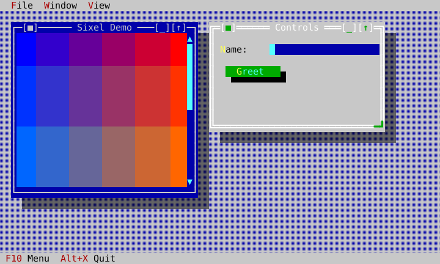

# Themes and rendering

Themes are role-based. Widgets resolve named roles from their attached
context, and applications can begin with `ui::make_classic_theme` before
supplying a different `Theme`. A subtree or window can override the roles it
uses without changing process-wide state.

The Gallery shows both document and dialog frame families in one real frame:



```text
widget state changes
  -> affected View invalidates
  -> Application composes the View tree
  -> Presenter emits changed terminal cells and raster overlays
```

You normally set a theme once during application construction, as every
example does:

<!-- ckvision-snippet source="examples/gallery/gallery_app.cpp" lines="20-25" -->
```cpp
GalleryApp::GalleryApp(ui::Application& app) : app_(app), roles_(ui::intern_standard_roles(app.roles())) {
    app_.theme() = ui::make_classic_theme(app_.roles(), roles_);

    auto desktop = std::make_unique<widgets::Desktop>(app_.root().bounds());
    desktop_ = desktop.get();
    app_.root().add_child(std::move(desktop));
```
<!-- /ckvision-snippet -->

The result is deterministic: clients supply services rather than having the UI
read wall-clock, locale, environment, or filesystem state behind their backs.
Paint calls are coordinated by `Application::step()`/`run()`; a client should
change widget state, not issue terminal escape sequences or manual repaint
loops. [Graphics](graphics.md) explains the one capability-sensitive surface.

The built-in themes distinguish two kinds of keyboard cue automatically.
`ckv.hotkey` accents a command chord in StatusLine and an `&` mnemonic in a
menu (red in Classic). `ckv.label.mnemonic` accents focus-changing labels,
buttons, checkboxes, and radio options inside dialogs (yellow in Classic).
Both preserve the receiving surface's background, so a highlighted menu row or
focused dialog control stays visually coherent.

Classic keeps action buttons and choice groups deliberately distinct: buttons
use green faces, while radio and check-group selection surfaces use cyan. This
prevents a persistent selection from reading as an immediate action.
Editable one-line fields use the dark-blue input surface, with a light-cyan
focused value, so form entry stays distinct from both static dialog text and
the cyan choice surface.

`ckv.help.text` is the separate reference-document role: Classic uses yellow
text on a blue window surface. This keeps preformatted help legible without
changing ordinary static dialog text.

`TextEditor` uses the standard `ckv.editor.*` family: text, gutter,
selection, search, and `ckv.editor.syntax.{plain,keyword,type,property,string,
number,comment,command,operator,escape,error}`. Classic, Dark, Light, Mono,
and High Contrast all define these roles explicitly. The paint precedence is selection first,
then search, then syntax/base text; a selected match therefore remains legible
under every built-in scheme. Applications may override any of these semantic
roles in an ordinary `Theme` without changing editor behavior or using a
global palette.
