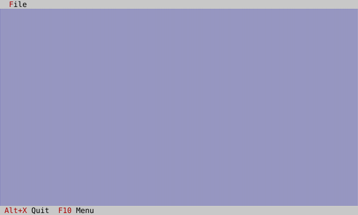
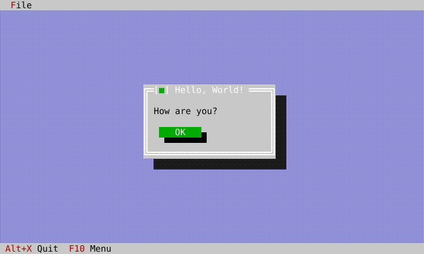

# Converting from Turbo Vision

This chapter is a worked example for anyone porting a Turbo Vision
(or Turbo-Vision-family) application to ckVision: the SAME small
application, built twice, compared construct by construct. The
ckVision side is `examples/hello/` in this repository — a real,
tested, buildable app, not a documentation-only snippet — and its
rendered output is pinned by a golden regression test
(`tests/test_hello_golden.cpp`) so this chapter cannot silently
drift out of sync with what the code actually does.

The source application is Turbo Vision's own tutorial example,
commonly distributed as `hello.cpp`: `THelloApp` — a desktop, a menu
bar with one custom command, a status line, and a "Hello, World!"
dialog with static text and four buttons. It is reproduced below only
as short, illustrative fragments in Turbo Vision's own well-documented
public API shape (`TApplication`, `TMenuBar`, `TDialog`, …) — not
copied verbatim from any Turbo Vision distribution — enough to compare
each construct directly against its ckVision equivalent.

## Side by side

### Application shell, desktop, menu bar, status line

Turbo Vision wires the desktop/menu/status line through virtual
factory methods `TApplication` calls during construction:

```cpp
class THelloApp : public TApplication {
public:
    THelloApp() : TProgInit(&initStatusLine, &initMenuBar, &initDeskTop) {}
    void handleEvent(TEvent& event) override;
    static TMenuBar* initMenuBar(TRect r) {
        r.b.y = r.a.y + 1;
        return new TMenuBar(r,
            *new TSubMenu("~H~ello", kbAltH) +
                *new TMenuItem("~G~reeting...", GreetThemCmd, kbAltG) +
                newLine() +
                *new TMenuItem("E~x~it", cmQuit, cmQuit, hcNoContext, "Alt-X"));
    }
    static TStatusLine* initStatusLine(TRect r) {
        r.a.y = r.b.y - 1;
        return new TStatusLine(r,
            *new TStatusDef(0, 0xFFFF) +
                *new TStatusItem("~Alt-X~ Exit", kbAltX, cmQuit) +
                *new TStatusItem(0, kbF10, cmMenu));
    }
};
```

ckVision has no equivalent "the framework calls back into your
factory methods" protocol — `Application`/`Desktop`/`MenuBar`/
`StatusLine` are plain, directly-constructed objects your own
constructor wires up in whatever order makes sense:

```cpp
constexpr ui::CommandId kCmdGreeting = ui::kFirstApplicationCommandId;
constexpr ui::CommandId kCmdQuit = ui::kFirstApplicationCommandId + 1;

HelloApp::HelloApp(ui::Application& app) : app_(app), roles_(ui::intern_standard_roles(app.roles())) {
    app_.theme() = ui::make_classic_theme(app_.roles(), roles_);
    desktop_ = app_.root().add(
        std::make_unique<widgets::Desktop>(app_.root().bounds(), app_.theme(), roles_.desktop_background));

    // F10 already activates the bar by default (M9/WP-13) — no handler
    // to wire here.
    std::vector<widgets::MenuBarItem> menus{
        {"&Hello", {{.command = kCmdGreeting}, {.separator = true}, {.command = kCmdQuit}}}};
    desktop_->dock_top(std::make_unique<widgets::MenuBar>(std::move(menus)));

    auto* status = desktop_->dock_bottom(std::make_unique<widgets::StatusLine>());
    status->set_role_override(roles_.menu_bar_normal);
    status->set_items({{.command = kCmdQuit}, {.command = ui::std_commands::kMenu}});

    auto& commands = app_.commands();
    commands.add({.id = kCmdGreeting, .title = "&Greeting...", .category = "Hello",
                  .chord = "Alt+G", .handler = [this] { greeting_box(); }});
    commands.add({.id = kCmdQuit, .title = "E&xit", .category = "Hello",
                  .chord = "Alt+X", .handler = [this] { app_.request_quit(); }});
}
```

The dialog body aside (next section), the shell is honestly about the
same length — 18 lines here against 20 for `THelloApp`'s two factory
methods combined. The real difference is **where the wiring lives**:
Turbo Vision's menu items and status items each carry a raw key-chord
constant (`kbAltG`) baked in at construction, invisible to anything
outside that one factory method; ckVision's commands are registered
once in `CommandRegistry` with their chord, title, and category
together (`CommandRegistry::add`, a single designated-initializer
call — M9/WP-10), and menu items / status-line items reference the
command by id alone, rendering their title, chord hint, and
enablement live from that one registration (M9/WP-11) — the SAME
registry a future help viewer, a keymap editor, or an exported
command reference can all introspect. `dock_top`/`dock_bottom` replace
the `r.b.y = r.a.y + 1` / `r.a.y = r.b.y - 1` manual rect surgery: the
menu bar and status line stay pinned to their edges across every
future resize automatically (see `widgets::Desktop::on_resized`),
which the original's one-time rect computation does not. F10 needs no
explicit handler at all — `MenuBar` installs itself as the standard
menu-activation command's default the moment it attaches (M9/WP-13) —
matching `TMenuBar`'s own built-in F10 behavior without ckVision
having to hard-code it outside the ordinary, rebindable command
keymap.

### The greeting dialog

Turbo Vision builds and runs the dialog inside one method, blocking
until a button fires `cmCancel`:

```cpp
void THelloApp::greetingBox() {
    TDialog* d = new TDialog(TRect(25, 5, 55, 16), "Hello, World!");
    d->insert(new TStaticText(TRect(3, 5, 15, 6), "How are you?"));
    d->insert(new TButton(TRect(16, 2, 28, 4), "Terrific", cmCancel, bfNormal));
    d->insert(new TButton(TRect(16, 4, 28, 6), "Ok", cmCancel, bfNormal));
    d->insert(new TButton(TRect(16, 6, 28, 8), "Lousy", cmCancel, bfNormal));
    d->insert(new TButton(TRect(16, 8, 28, 10), "Cancel", cmCancel, bfNormal));
    deskTop->execView(d);  // blocks here until a button fires cmCancel
    destroy(d);
}
```

ckVision's port (`examples/hello/hello_app.cpp`, `greeting_box()`):

```cpp
void HelloApp::greeting_box() {
    auto window = std::make_unique<widgets::Window>("Hello, World!");
    window->set_role_override(roles_.dialog_frame, roles_.dialog_background, roles_.dialog_frame,
                               roles_.dialog_background);
    window->set_bounds(Rect{25, 5, 30, 11});
    widgets::Window* window_ptr = window.get();

    window->add(std::make_unique<widgets::StaticText>("How are you?"))->set_bounds(Rect{3, 5, 12, 1});

    widgets::Button* first_button = nullptr;
    const std::pair<const char*, int> labels[] = {{"Terrific", 0}, {"Ok", 2}, {"Lousy", 4}, {"Cancel", 6}};
    for (const auto& [label, y] : labels) {
        auto* raw = window->add(std::make_unique<widgets::Button>(label));
        raw->set_bounds(Rect{16, y + 1, 12, 2});
        if (first_button == nullptr) first_button = raw;
        raw->on_press = [window_ptr] { window_ptr->close(); };
    }

    window->cancel_request = [window_ptr] { window_ptr->close(); };
    window->on_closed = [window_ptr, this] { schedule_self_detach(*window_ptr, app_); };
    desktop_->exec_window(app_, widgets::WindowHandle{std::move(window), first_button});
}
```

This is the one place the two sides genuinely diverge in size — 10
lines for `greetingBox()` against 19 here. The gap is real, not a
counting artifact: `TButton`'s constructor takes a command
(`cmCancel`) that Turbo Vision's own dialog machinery already knows
how to close on; ckVision's `Button` has no equivalent "close my
enclosing dialog" built-in, so each button gets its own explicit
`on_press` closure. That is a genuine ergonomics gap this port does
not paper over — a future "buttons that close their dialog by
default" convenience (in the spirit of `MessageBoxDescriptor`'s own
button set, but for hand-built dialogs) is a real candidate for a
later increment, not something this chapter should pretend already
exists.

Geometry: `TRect(25, 5, 55, 16)` is absolute desktop coordinates
`{x:25, y:5, width:30, height:11}` — `Window::set_bounds(Rect{25, 5,
30, 11})` is the direct translation. `TStaticText(TRect(3, 5, 15, 6),
...)` is `{x:3, y:5, width:12, height:1}` — width matches the
12-character "How are you?" exactly, same as the original. Every
control here is added directly as a child of `window` (not through a
separate `content()` view), so its own `Rect` is `window`-local — the
same frame of reference `insert()`'s own `TRect` arguments already use
relative to the dialog, rather than a further-nested content-interior
space. This chapter deliberately does not attempt to rederive Turbo
Vision's own precise interior-offset convention beyond what's directly
visible in the snippet above (per this project's own provenance rule,
`AGENTS.md` — no Turbo Vision source is consulted here); the resulting
layout is verified correct the way everything else in this chapter
is — against the pinned golden dump and screenshot, not by reasoning
about Turbo Vision's own internal geometry rules from the outside.

## Blocking without a nested native loop

Turbo Vision's `deskTop->execView(d)` **blocks the calling thread**
until the dialog is dismissed: it runs a nested event loop right there
in `greetingBox()`. Naively, ckVision's own embeddable loop
(`step()`/`wake()`, D-021 in `DECISIONS.md`) looks incompatible with
that — a host application drives ckVision from its own poll loop, and
a NESTED NATIVE loop the way `execView` works is explicitly rejected
by D-021, not merely deferred, since it would be hostile to embedding
and create re-entrancy hazards with `post()` and mid-modal
destruction. But D-021's actual design separates two things
`execView` conflates: modality (event routing scoped to the dialog,
`Application::push_modal`/`pop_modal`) and blocking (the calling code
waiting for a result). `Desktop::exec_window` (M9/WP-15) gives
`greeting_box()` BOTH, over the SAME embeddable loop — it pushes the
modal scope, then pumps `Application::step()` in a plain loop (no
nested native loop, no re-entrancy hazard: `post()`ed work and
mid-modal destruction both follow the ordinary single-loop rules)
until the window closes, then pops the scope and returns. The
CALLER's experience is indistinguishable from `execView`'s: the call
blocks, and by the time it returns the dialog is gone.

**Observable behavior is fully identical**, and so is this one
structural property that used to differ: all four buttons dismiss the
dialog, exactly as `hello.cpp`'s reader would expect
(`tests/test_hello_golden.cpp`:
`every_greeting_button_dismisses_the_dialog_matching_the_originals_shared_cmcancel`
drives all four and asserts the window closes each time); Esc also
dismisses it (`cancel_request`); nothing outside the dialog responds
while it's open
(`while_the_greeting_dialog_is_open_background_accelerators_are_scoped_out`
confirms Alt+X is inert until the dialog closes); and `greeting_box()`
itself now blocks its caller until dismissal, exactly like the
original — no residual difference for a reader to reconcile.

No other deviation was necessary. Layout, mnemonics (`&Greeting...` /
`~G~reeting...`), the Alt-G/Alt-X chords, the menu separator, and the
status line's two items all carry over directly.

## Visual comparison — confirmed, not assumed

Both screenshots below come from the SAME headless run
`tests/test_hello_golden.cpp` pins byte-exactly (via
`tools/docgen/capture_hello_screenshots`, driving the real render
pipeline — `scene::Compositor`/`term::Presenter` — not a mock).

Initial screen — desktop, menu bar, status line:



The greeting dialog (Alt+G) — a gray dialog surface exactly as the
original's `TDialog` is (dialogs are the gray family; blue is for
document windows), double-line active frame, centered padded title,
and the classic green buttons with their composited black drop shadow
(`▄`/`█` along the right edge, `▀` along the bottom — the focused
button's label renders white, and pressing one shifts its face a cell
right while the shadow disappears, the classic "push into the
surface" feedback):



In the Classic theme this is, deliberately, meant to look like a
faithful windowed-desktop application — not "inspired by," identical
in spirit: double-frame-on-focus, the ▲▼/◄► scrollbar glyphs, the `■`
close glyph and `↑`/`↕` zoom glyph, the light-shade desktop texture,
the gray-dialog/green-button palette with composited button shadows,
and the blue-window/light-gray-menu/green-highlight palette are all
covered by dedicated tests (see `tests/test_window.cpp`,
`tests/test_widgets.cpp`, `tests/test_scrollbar.cpp`,
`tests/test_standard_roles.cpp`) as well as by this chapter's own
golden dump. **No deviation from the original's visual language was
introduced in this port** — porting `hello.cpp` surfaced real
ckVision rendering gaps along the way (a window's content interior
was never filled at all, the zoom control's glyph silently overwrote
the frame's top-right corner, the title lacked its centered padding,
and buttons rendered as flat `[ Label ]` bars with none of the
original's face/shadow/pressed geometry), each fixed in the library
as part of landing this chapter, never worked around in the example.

## Verified, not just built

| Claim | Test |
|---|---|
| The initial frame matches the pinned golden dump byte-exactly | `hello_initial_frame_matches_the_pinned_golden_dump` |
| The greeting dialog matches the pinned golden dump byte-exactly | `hello_greeting_dialog_frame_matches_the_pinned_golden_dump` |
| Alt+G opens the dialog (matching the original's Alt-G mnemonic) | `alt_g_opens_the_greeting_dialog_matching_the_originals_alt_g_mnemonic` |
| Every button dismisses the dialog (matching the original's shared cmCancel) | `every_greeting_button_dismisses_the_dialog_matching_the_originals_shared_cmcancel` |
| Alt+X quits (matching the original's status-line shortcut) | `alt_x_quits_matching_the_originals_alt_x_status_line_shortcut` |

To regenerate the golden fixtures after a deliberate rendering change:

```bash
cmake --build build --target generate_hello_golden
build/tools/docgen/generate_hello_golden tests/golden
```

Review the diff like any other source change before committing —
regeneration is a manual, reviewed act, never automatic.
