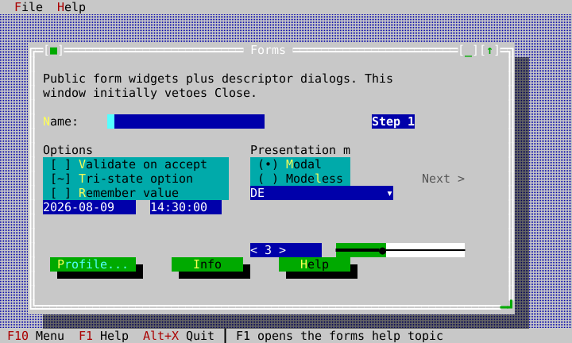
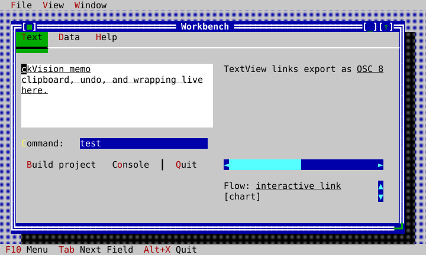
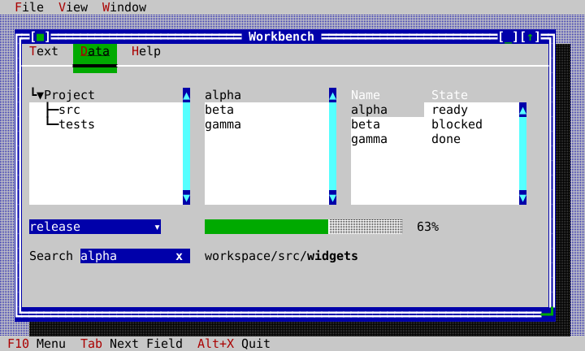
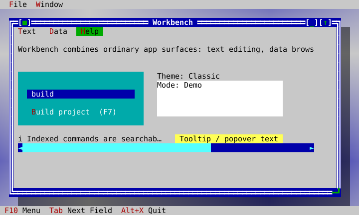
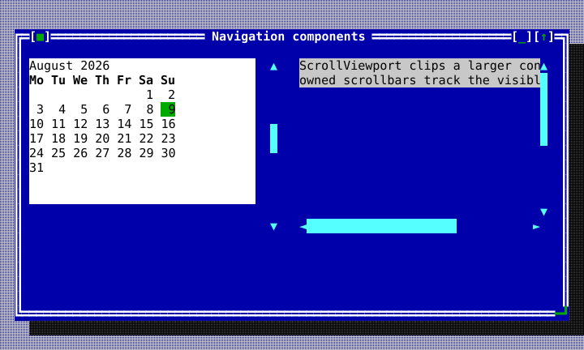

# Widget gallery

Every entry below names the public header, tells you where to place the type,
and points to a real example/capture. The code blocks are extracted from the
compiled example applications; run `tools/docgen/extract_snippets.py --write`
after changing their source rather than maintaining copy-pasted documentation.

The Forms frame is the compact reference for editable controls; the Workbench
tabs cover text/data/utility components.

| Forms | Workbench: text | Workbench: data | Workbench: utilities |
|---|---|---|---|
|  |  |  |  |

The navigation components have their own public-API capture because a calendar
and a scrolling viewport do not belong naturally in the compact Forms or
Workbench windows.



## DocumentPosition

Header: `include/cvision/widgets/editor_document.hpp`. A revision-bound,
grapheme-boundary byte position in an `EditorDocument`; obtain it from the
document instead of retaining an unversioned offset.

## DocumentRange

Header: `include/cvision/widgets/editor_document.hpp`. A half-open pair of
positions from one document revision. It is the unit accepted by replacement,
selection, and search results.

## DocumentLineColumn

Header: `include/cvision/widgets/editor_document.hpp`. A logical line and
grapheme column, not a terminal-cell coordinate.

## EditorDocumentOptions

Header: `include/cvision/widgets/editor_document.hpp`. Sets invalid-UTF-8 and
bounded undo-history policy when constructing a document.

## DocumentChange

Header: `include/cvision/widgets/editor_document.hpp`. The deterministic
revision/change record delivered to document observers.

## DocumentEditResult

Header: `include/cvision/widgets/editor_document.hpp`. The status and optional
change record returned by a document edit or transaction commit.

## DocumentTextEdit

Header: `include/cvision/widgets/editor_document.hpp`. A requested replacement
used to assemble a revision-atomic `DocumentTransaction`.

## DocumentTransaction

Header: `include/cvision/widgets/editor_document.hpp`. Collects non-overlapping
edits against one base revision; use it for replace-all and compound commands.

## EditorDocument

Header: `include/cvision/widgets/editor_document.hpp`. The shared persistent
UTF-8 document model for `TextEditor`; see [Editor](editor.md).

## SyntaxSpan

Header: `include/cvision/widgets/syntax_profile.hpp`. A semantic byte range in
one logical line emitted by a profile highlighter.

## SyntaxLineResult

Header: `include/cvision/widgets/syntax_profile.hpp`. Syntax spans plus the
next immutable lexer state for incremental line processing.

## LanguageDetectionInput

Header: `include/cvision/widgets/syntax_profile.hpp`. Explicit requested
profile, filename, prefix, and shebang data used for deterministic detection.

## LanguageDetection

Header: `include/cvision/widgets/syntax_profile.hpp`. A profile detector's
score and diagnostic reason.

## LanguageProfile

Header: `include/cvision/widgets/syntax_profile.hpp`. A stable language ID,
detector, and line highlighter registered by an application.

## SyntaxProfileRegistry

Header: `include/cvision/widgets/syntax_profile.hpp`. Instance-owned language
profile registry; the editor guide registers JSON, YAML, Bash, and plain text.

## SyntaxCacheLine

Header: `include/cvision/widgets/syntax_cache.hpp`. One cached source line:
the source text, validated semantic spans, and its incoming/outgoing lexer
state.

## SyntaxRelexReport

Header: `include/cvision/widgets/syntax_cache.hpp`. Deterministic evidence of
where an incremental lexical update began, how many lines it processed, and
whether it reached a state fixed point.

## SyntaxCache

Header: `include/cvision/widgets/syntax_cache.hpp`. A reusable incremental
line-state cache for a `LanguageProfile`; `TextEditor` uses it to avoid
rehighlighting an unchanged lexical suffix.

## EditorSearchQuery

Header: `include/cvision/widgets/editor_search.hpp`. The literal search text
and case/whole-word options for `EditorSearch`.

## EditorSearchMatch

Header: `include/cvision/widgets/editor_search.hpp`. A revision-bound match
range returned by deterministic literal search.

## EditorSearch

Header: `include/cvision/widgets/editor_search.hpp`. Finds literal matches and
performs one-transaction replace-all; see [Editor](editor.md#search-and-files).

## EditorStatus

Header: `include/cvision/widgets/text_editor.hpp`. Line/column, selection,
modified, overwrite, and profile data a client can place in its own status UI.

## EditorStatusModel

Header: `include/cvision/widgets/text_editor.hpp`. Scoped, instance-owned
observer model that mirrors one editor's status for independently composed
window chrome or status UI.

## TextEditor

Header: `include/cvision/widgets/text_editor.hpp`. The dedicated shared-
document editing view with keyboard/mouse selection, scrolling, gutter, syntax
roles, and clipboard commands. It is not a `Memo` replacement; see [Editor](editor.md).

## FileEditorController

Header: `include/cvision/widgets/file_editor_controller.hpp`. Explicit safe
load/save/save-as controller over an injected `FileSystem`, including external-
change conflict detection and newline preservation.

## EditorOpenOptions

Header: `include/cvision/widgets/file_editor_controller.hpp`. Per-open input
policy for `FileEditorController`. File input rejects malformed UTF-8 unless a
client deliberately passes `InvalidUtf8Policy::Replace`; the choice is local
to that open and does not silently alter the document's normal edit policy.
The same options require an explicit discard choice before replacing dirty
content with another file.

## EditorWindow

Header: `include/cvision/widgets/editor_window.hpp`. Optional reusable window
composition owning a `TextEditor`, `FileEditorController`, dirty title, status
overlay, and safe implicit close veto. Clients may instead compose the lower-
level editor and controller themselves.

## ApplicationShell

Header: `include/cvision/widgets/application_shell.hpp`. Use when a small app
needs a Desktop, classic theme, menu bar, and status line in one construction
step. [Hello](tutorial-hello.md) is the complete source; use explicit Desktop
construction when the shell needs more customization.

## ApplicationShellOptions

Header: `include/cvision/widgets/application_shell.hpp`. This aggregate
configures the shell's theme, menu definitions, and status items. Keep command
behavior in the Application registry and use the options only to present it.

## Button

Header: `include/cvision/widgets/button.hpp`. Put buttons in a window or
dialog content view; Space/Enter activate the focused/default button and a
mouse click invokes `on_press`. Use it for an immediate action, not a command
shortcut duplicated elsewhere. Forms shows default and ordinary buttons.

## Canvas

Header: `include/cvision/widgets/canvas.hpp`. Use for deterministic client
drawn raster content. Set bounds/cell metrics, install a draw callback, and
use `on_click` for pointer interaction; see [Graphics](graphics.md).

## ComboBox

Header: `include/cvision/widgets/combo_box.hpp`. Use `PickOnly` for a closed
choice set and `Editable` when the user can type a value. Arrow keys navigate
the popup; when the dropdown is closed, `Editable` uses the standard text
keymap (word/boundary navigation, Shift selection, Ctrl+C/X/V,
Ctrl+Insert/Shift+Insert, and word deletion). Forms and Workbench show both
modes.

## CommandPresentation

Header: `include/cvision/widgets/command_presentation.hpp`. This value maps a
registered command to a menu/status/toolbar surface. It inherits title, chord,
and enablement from the registry; [dialogs and commands](dialogs-and-commands.md)
shows the real Hello source.

## CalendarView

Header: `include/cvision/widgets/common_components.hpp`. Use for a visible
month calendar where the user moves a date selection with arrows/page keys.
Place it in a dialog or application content view; pair it with DatePicker for
a compact field. It appears in the navigation capture above.

## DateValue

Header: `include/cvision/widgets/common_components.hpp`. A plain deterministic
year/month/day value used by CalendarView and DatePicker; Forms initializes one
in the source-backed control setup below.

## TimeValue

Header: `include/cvision/widgets/common_components.hpp`. A plain hour/minute/
second value used by TimePicker; it has no implicit system-clock behavior.

## DatePicker

Header: `include/cvision/widgets/common_components.hpp`. Use for a compact
date field. Keyboard editing and arrows adjust the focused portion; choose it
over CalendarView when screen space is tight.

## TimePicker

Header: `include/cvision/widgets/common_components.hpp`. Use for a compact
time field. Arrow keys adjust the active component; the caller supplies and
reads a `TimeValue`.

## SpinBox

Header: `include/cvision/widgets/common_components.hpp`. Use for a small
bounded integer. Set the range before setting the value; arrows and mouse
controls change it in range.

## Slider

Header: `include/cvision/widgets/common_components.hpp`. Use for a bounded
continuous-looking value where a visual position is useful. Arrows and pointer
input adjust the value; retain a textual value/label when precision matters.

## SearchBox

Header: `include/cvision/widgets/common_components.hpp`. Use for a query field
with search affordance. It owns query editing; the application decides how and
when to execute the search.

## ToolBar

Header: `include/cvision/widgets/common_components.hpp`. Use to present a
short list of registered commands near document content. It follows command
enablement and executes the same handler as a menu/status item.

## CommandPalette

Header: `include/cvision/widgets/common_components.hpp`. Use for searchable
command discovery. Give it command context and query state; activation remains
the registry command path rather than a palette-only callback.

## BreadcrumbBar

Header: `include/cvision/widgets/common_components.hpp`. Use to display a
hierarchical location. It is a view in normal content chrome, not a replacement
for a TreeView when the user needs expansion/navigation.

## PropertyItem

Header: `include/cvision/widgets/common_components.hpp`. A name/value/editable
record consumed by PropertyInspector.

## PropertyInspector

Header: `include/cvision/widgets/common_components.hpp`. Use to inspect or
edit a small named set of properties. Workbench shows the visual pattern.

## WizardPage

Header: `include/cvision/widgets/common_components.hpp`. Supply a title and a
predicate for forward validity. The predicate is the correct place for the
state-dependent Next policy.

## Wizard

Header: `include/cvision/widgets/common_components.hpp`. Use a sequence of
dialog-like pages with Back/Next. It enables Next only when the current page's
predicate accepts; see [Dialogs](dialogs-and-commands.md#wizard-state-dependent-next).

## Notification

Header: `include/cvision/widgets/common_components.hpp`. A severity/message/
dismissibility record owned by NotificationCenter.

## NotificationCenter

Header: `include/cvision/widgets/common_components.hpp`. Use for non-modal
application feedback. It does not replace a modal message box when a decision
or acknowledgement is required.

## Tooltip

Header: `include/cvision/widgets/common_components.hpp`. Use for short
contextual help. Show it at an explicit point; it is not a focusable dialog.

The Forms example's exact setup supplies DatePicker, TimePicker, SpinBox,
Slider, and Wizard with real values and ownership.

<!-- ckvision-snippet source="examples/forms/forms_app.cpp" lines="112-149" -->
```cpp
    content->add_child(std::move(mode));

    auto country = std::make_unique<widgets::ComboBox>(widgets::ComboBoxMode::Editable);
    country->set_bounds(Rect{30, 9, 20, 4});
    country->set_items({"US", "DE", "FR", "JP"});
    country->set_text("DE");
    country_ = country.get();
    content->add_child(std::move(country));

    auto date = std::make_unique<widgets::DatePicker>();
    date->set_bounds(Rect{1, 10, 13, 1});
    date->set_value(widgets::DateValue{2026, 8, 9});
    date_picker_ = date.get();
    content->add_child(std::move(date));

    auto time = std::make_unique<widgets::TimePicker>();
    time->set_bounds(Rect{16, 10, 10, 1});
    time->set_value(widgets::TimeValue{14, 30, 0});
    time_picker_ = time.get();
    content->add_child(std::move(time));

    auto spin = std::make_unique<widgets::SpinBox>();
    spin->set_bounds(Rect{30, 13, 10, 1});
    spin->set_range(0, 10);
    spin->set_value(3);
    spin_box_ = spin.get();
    content->add_child(std::move(spin));

    auto slider = std::make_unique<widgets::Slider>();
    slider->set_bounds(Rect{42, 13, 18, 1});
    slider->set_value(40);
    slider_ = slider.get();
    content->add_child(std::move(slider));

    auto wizard = std::make_unique<widgets::Wizard>();
    wizard->set_bounds(Rect{47, 4, 16, 5});
    wizard->set_pages({widgets::WizardPage{"Step 1", [this] { return !name_input_->text().empty(); }},
                       widgets::WizardPage{"Step 2", [] { return true; }}});
```
<!-- /ckvision-snippet -->

## Desktop

Header: `include/cvision/widgets/desktop.hpp`. Insert one below the
Application root. It owns window z-order, docks, popups, activation, and
desktop-wide tile/cascade commands; do not use a global desktop singleton.

## FieldDescriptor

Header: `include/cvision/widgets/dialog.hpp`. A label/initial-value/validator
record used to materialize a descriptor dialog.

## ButtonDescriptor

Header: `include/cvision/widgets/dialog.hpp`. Defines a dialog action,
including whether it is the accept/default action.

## DialogDescriptor

Header: `include/cvision/widgets/dialog.hpp`. Use for a standard form dialog
when declarative fields and validation are sufficient; see [Dialogs](dialogs-and-commands.md).

## MaterializedDialog

Header: `include/cvision/widgets/dialog.hpp`. The materialized view/result of
a descriptor; normally use `present_dialog` instead of manually managing it.

## DialogResult

Header: `include/cvision/widgets/dialog.hpp`. Typed completion payload for a
descriptor dialog. Inspect it in the presentation completion handler.

## DialogFocusRestore

Header: `include/cvision/widgets/dialog_presentation.hpp`. Presentation helper
that restores the invoking focus after modal close; use the public presentation
functions rather than constructing it directly.

## DialogPresentationAccess

Header: `include/cvision/widgets/dialog_presentation.hpp`. Internal access
surface for typed presentations; clients consume the typed aliases returned by
the standard `present_*` functions.

## DirectoryPickerResult

Header: `include/cvision/widgets/directory_picker.hpp`. Typed result from the
directory-picker presentation. Inject a FileSystem; never make the widget read
the disk implicitly.

## FileDialogFilter

Header: `include/cvision/widgets/file_dialog.hpp`. Describes a displayed file
filter for the standard open/save dialog.

## FileDialogOptions

Header: `include/cvision/widgets/file_dialog.hpp`. Options record for the
standard file dialog, including mode and filters.

## FileDialogResult

Header: `include/cvision/widgets/file_dialog.hpp`. Typed result from an
open/save presentation.

## HelpTopic

Header: `include/cvision/widgets/help_viewer.hpp`. Text/title/link data for a
help topic supplied by your `HelpProvider`.

## HelpIndexEntry

Header: `include/cvision/widgets/help_viewer.hpp`. Search/index record emitted
by a help provider.

## HelpProvider

Header: `include/cvision/widgets/help_viewer.hpp`. Abstract, injected source
of help topics. It keeps help content under application ownership.

## MemoryHelpProvider

Header: `include/cvision/widgets/help_viewer.hpp`. Deterministic in-memory
provider suitable for small applications and tests; Forms uses it.

## ImageView

Header: `include/cvision/widgets/image_view.hpp`. Use to display an `Image`.
It renders raster output if the terminal supports it and a cell fallback if it
does not; [Graphics](graphics.md) shows both captures.

## InputLine

Header: `include/cvision/widgets/input_line.hpp`. Use for one-line text with
grapheme-aware editing, selection, validation, masks, password echo, history,
clipboard, and undo. Text events edit it; arrows/home/end and mouse adjust its
cursor/selection. Ctrl+Left/Right moves by word, Ctrl+Home/End reaches the
field boundaries, and Shift extends any cursor motion. Ctrl+C/X/V and
Ctrl+Insert/Shift+Insert copy, cut, and paste; Ctrl+Backspace/Delete erase by
word, while Shift+Delete cuts the selection. Forms shows a labelled field.

## Label

Header: `include/cvision/widgets/label.hpp`. Use a mnemonic label next to a
control; it participates in mnemonic focus routing. Use StaticText for passive
wrapped copy.

## ListView

Header: `include/cvision/widgets/list_view.hpp`. Use a linear selectable
collection. Arrow keys select and Enter activates; File Browser connects it to
TreeView selection.

## Memo

Header: `include/cvision/widgets/memo.hpp`. Use for multiline editable text
with undo and optional wrapping. It handles cursor keys, text input, scrolling,
and clipboard through Application services. It uses the same editing keymap as
InputLine: Ctrl+Left/Right moves by word, Ctrl+Home/End reaches document
boundaries, Shift extends selections, and Ctrl+C/X/V or
Ctrl+Insert/Shift+Insert provide clipboard operations. Ctrl+Backspace/Delete
erase by word; Shift+Delete cuts the current selection.

## MnemonicText

Header: `include/cvision/widgets/mnemonic.hpp`. Parsed label/mnemonic value
used by controls that accept `&` mnemonic notation.

## MenuItem

Header: `include/cvision/widgets/menu.hpp`. A menu row: prefer a
`CommandPresentation` for command actions; use a callback row only for a truly
local action such as opening a contextual dialog.

## DropdownMenu

Header: `include/cvision/widgets/menu.hpp`. A transient menu surface owned by
the menu system. Arrow keys/mnemonics select, Enter activates, and Escape/light
dismiss returns focus. Its `&` mnemonic uses the shared `ckv.hotkey` accent.

## MenuBarItem

Header: `include/cvision/widgets/menu.hpp`. Top-level label plus its MenuItem
rows, normally constructed before making a MenuBar.

## MenuBar

Header: `include/cvision/widgets/menu.hpp`. Dock it at the Desktop top. F10
activates the standard menu command, mnemonics enter menus, Escape restores
the preceding focus. Its mnemonic letters use the shared `ckv.hotkey` accent.
The [Hello tutorial](tutorial-hello.md) shows it open.

## MemoPosition

Header: `include/cvision/widgets/memo.hpp`. A line/grapheme position value for
Memo cursor and selection APIs.

## MessageBoxDescriptor

Header: `include/cvision/widgets/message_box.hpp`. A kind/title/message/button
set record for `present_message_box`; use a completion handler for its typed result.

## CheckGroup

Header: `include/cvision/widgets/option_group.hpp`. Use multiple independent
choices. Arrows select a row and Space toggles it; optionally enable tri-state
values as shown in Forms. Its visual contract is square `[ ]`/`[X]` markers.
`set_group_label()` gives the group an owned caption one row above the choices;
the caption changes from its normal label colour to the focused-option
foreground while the group owns keyboard focus.

## RadioGroup

Header: `include/cvision/widgets/option_group.hpp`. Use exactly one choice.
Arrows and mnemonics change its selected index. Its visual contract is rounded
`( )`/`(U+2022)` markers. `set_group_label()` gives the group an owned caption
one row above the choices; the caption changes from its normal label colour to
the focused-option foreground while the group owns keyboard focus.

## Progress

Header: `include/cvision/widgets/progress.hpp`. Use a determinate fraction
with an optional label; application work updates it through `set_fraction`.

## ScrollViewport

Header: `include/cvision/widgets/scroll_viewport.hpp`. Use to expose a larger
child view through a clipped scrollable region. Pair with Scrollbar when a
visible position control helps. Both appear in the navigation capture above.

## Scrollbar

Header: `include/cvision/widgets/scrollbar.hpp`. Use for an explicit vertical
or horizontal scroll position. Arrow/page keys and pointer interaction adjust
its model; orientation comes from `Orientation`. The built-in presentation uses
the CP437-style U+25B2/U+25BC or U+25C4/U+25BA arrows, a U+2591 light-shade
page area, and a U+2588 full-block proportional thumb. The active scheme owns
their colours.

## Splitter

Header: `include/cvision/widgets/splitter.hpp`. Use exactly two adjacent panes
with user-controlled division. Focus it and use its directional keys, or drag
the divider. [Layout guide](layout-guide.md) and File Browser show it.

## StandardStrings

Header: `include/cvision/widgets/standard_strings.hpp`. Application-local
standard dialog wording; pass it to factories instead of installing global
localization state.

## StaticText

Header: `include/cvision/widgets/static_text.hpp`. Use passive, wrapping text.
It is not editable/focusable like Memo or TextView links.

## StatusLineItem

Header: `include/cvision/widgets/status_line.hpp`. A command presentation or
short status surface entry used by StatusLine.

## StatusLine

Header: `include/cvision/widgets/status_line.hpp`. Dock it at Desktop bottom
for command hints and contextual help. Its command item executes the same
registry action as a menu item; the registered key chord automatically uses
the same `ckv.hotkey` accent as menu mnemonics.

## TabControl

Header: `include/cvision/widgets/tab_control.hpp`. Use mutually exclusive
pages within one window. Mnemonics/keyboard navigation change active page;
Workbench and Graphics provide real tab captures.

## TableColumn

Header: `include/cvision/widgets/table.hpp`. Defines a Table header and sizing
constraints.

## Table

Header: `include/cvision/widgets/table.hpp`. Use aligned sortable rows/columns.
Arrow keys navigate; client code supplies columns/rows and chooses sorting.

## TerminalView

Header: `include/cvision/widgets/terminal_view.hpp`. Hosts one explicitly
launched `TerminalSubsession` in a normal view tree. It renders the private
child snapshot, forwards the child input modes it requests, and keeps parent
focus under the application's control; see [Embedded terminal](embedded-terminal.md).

## TextSpan

Header: `include/cvision/widgets/text_view.hpp`. Styled/link-capable fragment
used by TextView.

## TextView

Header: `include/cvision/widgets/text_view.hpp`. Use passive rich/wrapped text
or link content. Its link activation callback receives the target; Workbench
shows an OSC 8-capable link span.

## TreeNode

Header: `include/cvision/widgets/tree_view.hpp`. A hierarchy node with label,
children, expansion state, and optional client data.

## TreeView

Header: `include/cvision/widgets/tree_view.hpp`. Use hierarchical navigation.
Arrows select/expand, Enter activates, and `on_expand_request` supports lazy
children. File Browser uses the public selection callback to update a ListView.

## FrameSlot

Header: `include/cvision/widgets/window.hpp`. Chooses a Window frame overlay
edge/alignment/offset; use it for border metadata such as a current path.

## Window

Header: `include/cvision/widgets/window.hpp`. Desktop owns modeless windows.
Their title bars move, borders resize when enabled, and a close request may be
vetoed by application policy. Resizable focused windows expose one-cell
single-line grips at both lower corners inside their otherwise double-line
frame; dragging the left grip anchors the right edge. Put one content view inside each window. A
window using `DesktopGrowPolicy::KeepFilling` is permanently maximized: its
title control automatically shows the U+2195 restore glyph even though `zoomed()`
remains false (there is no transient geometry to restore). Its maximize/restore
control uses the theme's `ckv.window.control` accent while its brackets retain
the frame background and foreground.

## WindowHandle

Header: `include/cvision/widgets/window.hpp`. Stable window identity used for
activation/listing operations without exposing ownership.

## Window list dialog

Header: `include/cvision/widgets/window_list_dialog.hpp`. The standard typed
dialog for choosing/activating Desktop windows; use its presentation alias and
result enum rather than building a one-off window list.

The Workbench source shows the text/data family in the exact compiled app:

<!-- ckvision-snippet source="examples/workbench/workbench_app.cpp" lines="71-170" -->
```cpp
std::unique_ptr<ui::View> WorkbenchApp::build_text_page() {
    auto page = std::make_unique<ui::View>();

    auto memo = std::make_unique<widgets::Memo>();
    memo->set_bounds(Rect{1, 1, 36, 10});
    memo->set_word_wrap(true);
    memo->set_text("ckVision memo\nclipboard, undo, and wrapping live here.");
    memo_ = memo.get();
    page->add_child(std::move(memo));

    auto command_label = std::make_unique<widgets::Label>("&Command:");
    command_label->set_bounds(Rect{1, 12, 10, 1});
    page->add_child(std::move(command_label));

    auto command = std::make_unique<widgets::InputLine>();
    command->set_bounds(Rect{12, 12, 24, 1});
    command->set_history(&history_, "workbench.command");
    command->set_text("build");
    command->commit_to_history();
    command->set_text("test");
    command->commit_to_history();
    command_input_ = command.get();
    page->add_child(std::move(command));

    auto toolbar = std::make_unique<widgets::ToolBar>();
    toolbar->set_bounds(Rect{1, 14, 34, 1});
    toolbar->set_commands({ui::std_commands::kMenu, ui::std_commands::kQuit});
    tool_bar_ = toolbar.get();
    page->add_child(std::move(toolbar));

    auto text = std::make_unique<widgets::TextView>();
    text->set_bounds(Rect{39, 1, 30, 12});
    text->set_spans({widgets::TextSpan{"TextView links export as ", static_cast<Attr>(0), std::nullopt},
                     widgets::TextSpan{"OSC 8", Attr::Underline, std::string{"https://example.invalid/osc8"}},
                     widgets::TextSpan{" and activate deterministically.", static_cast<Attr>(0), std::nullopt}});
    text->set_current_link(0);
    text->on_link_activate = [this](const std::string& target) { last_link_ = target; };
    text_view_ = text.get();
    page->add_child(std::move(text));

    return page;
}

std::unique_ptr<ui::View> WorkbenchApp::build_data_page() {
    auto page = std::make_unique<ui::View>();

    auto tree = std::make_unique<widgets::TreeView>();
    tree->set_bounds(Rect{1, 1, 22, 10});
    tree->set_connector_style(widgets::TreeConnectorStyle::BoxDrawing);
    widgets::TreeNode src;
    src.label = "src";
    widgets::TreeNode tests;
    tests.label = "tests";
    widgets::TreeNode project;
    project.label = "Project";
    project.children = {std::move(src), std::move(tests)};
    project.expanded = true;
    tree->set_roots({std::move(project)});
    tree_ = tree.get();
    page->add_child(std::move(tree));

    auto list = std::make_unique<widgets::ListView>(true);
    list->set_bounds(Rect{25, 1, 18, 10});
    list->set_items({"alpha", "beta", "gamma"});
    list->set_selected(0, true);
    list_ = list.get();
    page->add_child(std::move(list));

    auto table = std::make_unique<widgets::Table>();
    table->set_bounds(Rect{45, 1, 24, 8});
    table->set_columns({widgets::TableColumn{"Name", 10, 4}, widgets::TableColumn{"State", 10, 4}});
    table->set_rows({{"alpha", "ready"}, {"beta", "blocked"}, {"gamma", "done"}});
    table_ = table.get();
    page->add_child(std::move(table));

    auto combo = std::make_unique<widgets::ComboBox>(widgets::ComboBoxMode::PickOnly);
    combo->set_bounds(Rect{1, 12, 18, 4});
    combo->set_items({"debug", "release", "asan"});
    combo->set_selected_index(1);
    combo_ = combo.get();
    page->add_child(std::move(combo));

    auto progress = std::make_unique<widgets::Progress>();
    progress->set_bounds(Rect{25, 13, 32, 1});
    progress->set_fraction(0.625);
    progress->set_label("62%");
    progress_ = progress.get();
    page->add_child(std::move(progress));

    auto search = std::make_unique<widgets::SearchBox>();
    search->set_bounds(Rect{1, 15, 22, 1});
    search->set_query("alpha");
    search_box_ = search.get();
    page->add_child(std::move(search));

    auto breadcrumb = std::make_unique<widgets::BreadcrumbBar>();
    breadcrumb->set_bounds(Rect{25, 15, 30, 1});
    breadcrumb->set_segments({"workspace", "src", "widgets"});
    breadcrumb_ = breadcrumb.get();
    page->add_child(std::move(breadcrumb));
```
<!-- /ckvision-snippet -->
